# Y — Database documentation
Schema proposal for the Y app, version 0.9 of 2026-10-19 (matches the DBML). Derived from the design boards of Desktop, Tablet and Mobile. The source of truth is [`y-database.dbml`](y-database.dbml) in this folder. Requires **PostgreSQL 18.6**, pinned by digest (DEC-070, DEC-126). The local development server listens on port 5434 (DEC-125).
> **Status: draft.** Decisions D1 to D13 are applied as **validated defaults** (decision journal, 2026-10-16). The age check uses VerifAge (DEC-019); its exact mechanism is pending the API documentation (DEC-020, R15). Items still marked **TO CONFIRM** are open. Version 0.7 applies DEC-080 to DEC-092 to the model; version 0.8 adds `support_threads.closed_by_lift` (DEC-117); version 0.9 applies DEC-119 to DEC-124 (indexes, French full-text search, hashtag prefix index, `updated_at` set by the application); version 0.10 adds `idempotency_keys` (section 9.1, 24-hour expiry) and the 1-to-280 CHECK on `replies.body`; the worked example in section 7 must be recalculated (**À recalculer**).

## Contents
- [1. Accounts and authentication](#1-accounts-and-authentication)
- [2. Sessions](#2-sessions)
- [3. Social graph](#3-social-graph)
- [4. Content](#4-content)
- [5. Messages](#5-messages)
- [6. Notifications and moderation](#6-notifications-and-moderation)
- [7. Administration](#7-administration)
- [8. Contact](#8-contact)
- [Enums](#enums)
- [Conventions](#conventions)
- [Open questions](#open-questions)

## Overview
Y is a question-based app in French. Users post short questions (280 characters, text only), react to them with **J'aime**, **Pas d'accord** or **Y**, and reply once a question has reached 50 Y. Each user has one reaction per question. Questions are grouped by hashtags only. Users can follow each other, block each other, save questions, send private messages, and receive notifications.

## Relationship diagram
Lines link a table to the table its foreign key points to. The label is the foreign key column.

```mermaid
erDiagram
    users ||--o{ signup_codes : "user_id"
    users ||--o{ password_reset_codes : "user_id"
    users ||--o{ email_change_codes : "user_id"
    users ||--o| age_verifications : "user_id"
    users |o--o{ login_events : "user_id"
    users ||--o{ follows : "follower_id"
    users ||--o{ follows : "followee_id"
    users ||--o{ blocks : "blocker_id"
    users ||--o{ blocks : "blocked_id"
    users ||--o{ questions : "author_id"
    questions ||--o{ replies : "question_id"
    users ||--o{ replies : "author_id"
    users ||--o{ question_reactions : "user_id"
    questions ||--o{ question_reactions : "question_id"
    users ||--o{ reply_reactions : "user_id"
    replies ||--o{ reply_reactions : "reply_id"
    replies |o--o{ mentions : "reply_id"
    questions |o--o{ mentions : "question_id"
    users ||--o{ mentions : "mentioned_user_id"
    questions ||--o{ question_hashtags : "question_id"
    hashtags ||--o{ question_hashtags : "hashtag_id"
    users ||--o{ bookmarks : "user_id"
    questions ||--o{ bookmarks : "question_id"
    users |o--o{ conversations : "initiated_by_id"
    conversations ||--o{ conversation_participants : "conversation_id"
    users ||--o{ conversation_participants : "user_id"
    conversations ||--o{ messages : "conversation_id"
    users ||--o{ messages : "sender_id"
    questions |o--o{ messages : "shared_question_id"
    users ||--o{ notifications : "recipient_id"
    users |o--o{ notifications : "actor_id"
    questions |o--o{ notifications : "question_id"
    replies |o--o{ notifications : "reply_id"
    users ||--o{ notification_preferences : "user_id"
    users ||--o{ reports : "reporter_id"
    users |o--o{ reports : "reviewed_by_id"
    questions |o--o{ reports : "question_id"
    replies |o--o{ reports : "reply_id"
    users |o--o{ sessions : "user_id"
    users |o--o{ admin_audit_log : "actor_id"
    users ||--o| admin_mfa : "user_id"
    users ||--o{ admin_backup_codes : "user_id"
    users ||--o{ support_threads : "user_id"
    users |o--o{ support_threads : "closed_by_id"
    support_threads ||--o{ support_messages : "thread_id"
    users |o--o{ support_messages : "author_user_id"
```


## 1. Accounts and authentication
Who can log in, how their identity is checked, and the codes used to confirm actions.

### `users`

Every person with an account. This is the central table: almost every other table points to it.

**Links:** none. This is a root table or a standalone table.

**Columns**

| Column | Type | Required | Key | Default | Description |
|---|---|---|---|---|---|
| `id` | `uuid` | Yes | Primary key | generated (UUID) | Unique identifier of the account. |
| `handle` | `varchar(30)` | Yes | Unique |  | Public identifier, shown as @corentin. Unique regardless of letter case, through a unique index on lower(handle) (DEC-061, DEC-070). ASCII letters, digits and underscore only. |
| `display_name` | `varchar(50)` | Yes | — |  | Name shown on posts and profiles, e.g. «Corentin Laborie». Required at signup (DEC-083), editable later (DEC-105). |
| `email` | `varchar(254)` | Yes | Unique |  | Login email address. Unique, stored in lowercase. Replaced by a unique placeholder at purge (DEC-024). |
| `phone` | `varchar(20)` | No | Unique |  | Optional (D2). Stored normalised, e.g. 0601020304. Not used for login in v1. Not editable in v1 (DEC-105). |
| `password_hash` | `varchar(255)` | Yes | — |  | Hash of the password. The plain password is never stored. Replaced by an unusable value at purge (DEC-024). |
| `birth_date` | `date` | No | — |  | Date of birth. Signup rejects users under 18. Null after purge. Age check: VerifAge (DEC-019). |
| `bio` | `varchar(160)` | No | — |  | Short profile biography. Maximum 160 characters (D3). |
| `avatar_url` | `varchar(2048)` | No | — |  | Link to the profile picture. |
| `status` | `account_status` | Yes | — | `pending_verification` | `pending_verification`, `active`, `suspended` (by the administrator), `pending_deletion` (90-day window, R16) or `deleted` (purged). Only `active` accounts can post, react, reply, follow or bookmark (R13, DEC-086). Content of accounts that are not `active` is hidden from others (DEC-086, DEC-087). |
| `role` | `user_role` | Yes | — | `user` | `user`, `moderator` or `admin`. Moderators handle reports (M7). Set by an admin, never by the user. |
| `terms_accepted_at` | `timestamptz(3)` | Yes | — |  | When the user accepted the terms of use at signup. |
| `terms_version` | `varchar(20)` | Yes | — |  | Version of the terms accepted. `1.0` for the first texts (DEC-062). |
| `email_verified_at` | `timestamptz(3)` | No | — |  | When the email address was verified. Empty until then. |
| `status_changed_at` | `timestamptz(3)` | No | — |  | When the status was last changed (suspension, reactivation, deletion request). |
| `suspension_reason` | `varchar(500)` | No | — |  | Reason shown to the user in the banner. Required when `status` is `suspended` (application rule, DEC-081). The history stays in `admin_audit_log`. |
| `failed_login_count` | `int` | Yes | — | `0` | Consecutive failed logins. Reset on success. Stored in the database so it survives restarts (DEC-040). |
| `locked_until` | `timestamptz(3)` | No | — |  | Login locked until this time after 5 failures (15 minutes, DEC-040). |
| `deletion_requested_at` | `timestamptz(3)` | No | — |  | When the user asked for deletion (DEC-024). |
| `deletion_purge_at` | `timestamptz(3)` | No | — |  | Date of the purge: `deletion_requested_at` + 90 days. Read by the daily purge job. |
| `deleted_at` | `timestamptz(3)` | No | — |  | When the account was purged. |
| `follower_count` | `int` | Yes | — | `0` | Number of followers, kept up to date. Shown as «2 340 abonnés». |
| `following_count` | `int` | Yes | — | `0` | Number of accounts this user follows. Shown as «182 abonnements». |
| `created_at` | `timestamptz(3)` | Yes | — | current time (UTC) | When the account was created. Shown as «A rejoint Y en mars 2026». |
| `updated_at` | `timestamptz(3)` | Yes | — | current time (UTC) | When the account row was last changed. Set by the application (DEC-123). |

**Indexes**

- Index on (`status`)
- Index on (`status`, `deletion_purge_at`) — the daily purge job

### `signup_codes`

One-time codes sent by email to confirm a new account, used on the «Code» screen after signup. A resend invalidates the previous unconsumed codes of the same user and creates a new row.

**Links**

- `user_id` → `users.id` (many `signup_codes` rows per `users` row)

**Columns**

| Column | Type | Required | Key | Default | Description |
|---|---|---|---|---|---|
| `id` | `uuid` | Yes | Primary key | generated (UUID) | Unique identifier of the code. |
| `user_id` | `uuid` | Yes | FK → `users.id` |  | The account being verified. |
| `code_hash` | `varchar(255)` | Yes | — |  | Hash of the 6-digit code sent by email. The code itself is never stored. |
| `attempts` | `int` | Yes | — | `0` | Number of wrong codes entered. At 5, the code is invalidated (D8). |
| `expires_at` | `timestamptz(3)` | Yes | — |  | When the code stops being valid. Lifetime 15 minutes (D8). |
| `consumed_at` | `timestamptz(3)` | No | — |  | When the code was successfully used. Empty if not used yet. |
| `created_at` | `timestamptz(3)` | Yes | — | current time (UTC) | When the code was sent. |

**Indexes**

- Index on (`user_id`, `created_at`)

### `password_reset_codes`

One-time codes for the «Mot de passe oublié» flow. Same rules as `signup_codes` (15 minutes, 5 attempts). A new request invalidates the previous unconsumed codes.

**Links**

- `user_id` → `users.id` (many `password_reset_codes` rows per `users` row)

**Columns**

| Column | Type | Required | Key | Default | Description |
|---|---|---|---|---|---|
| `id` | `uuid` | Yes | Primary key | generated (UUID) | Unique identifier of the code. |
| `user_id` | `uuid` | Yes | FK → `users.id` |  | The account whose password is being reset. |
| `code_hash` | `varchar(255)` | Yes | — |  | Hash of the 6-digit code sent by email. |
| `attempts` | `int` | Yes | — | `0` | Number of wrong codes entered. At 5, the code is invalidated (D8). |
| `expires_at` | `timestamptz(3)` | Yes | — |  | When the code stops being valid. Lifetime 15 minutes (D8). |
| `consumed_at` | `timestamptz(3)` | No | — |  | When the code was used to reset the password. Empty if not used yet. |
| `created_at` | `timestamptz(3)` | Yes | — | current time (UTC) | When the code was sent. |

**Indexes**

- Index on (`user_id`, `created_at`)

### `email_change_codes`

One-time codes that confirm a new email address («Modifier e-mail»). The new address is kept here until the code is validated, then copied to `users.email`. The change is also announced to the old address (product doc, section 13).

**Links**

- `user_id` → `users.id` (many `email_change_codes` rows per `users` row)

**Columns**

| Column | Type | Required | Key | Default | Description |
|---|---|---|---|---|---|
| `id` | `uuid` | Yes | Primary key | generated (UUID) | Unique identifier of the code. |
| `user_id` | `uuid` | Yes | FK → `users.id` |  | The account changing its email address. |
| `new_email` | `varchar(254)` | Yes | — |  | The new email address. `users.email` only changes after the code is validated. |
| `code_hash` | `varchar(255)` | Yes | — |  | Hash of the 6-digit code sent to the new address. |
| `attempts` | `int` | Yes | — | `0` | Number of wrong codes entered. At 5, the code is invalidated (D8). |
| `expires_at` | `timestamptz(3)` | Yes | — |  | When the code stops being valid. Lifetime 15 minutes (D8). |
| `consumed_at` | `timestamptz(3)` | No | — |  | When the code was validated. Empty if not validated yet. |
| `created_at` | `timestamptz(3)` | Yes | — | current time (UTC) | When the code was sent. |

**Indexes**

- Index on (`user_id`, `created_at`)

### `age_verifications`

Result of the 18+ age check through the VerifAge service (DEC-019). Each user has at most one. The mechanism (callback with server-side confirmation, DEC-020) waits for the VerifAge API documentation.

**Links**

- `user_id` → `users.id` (one-to-one)

**Columns**

| Column | Type | Required | Key | Default | Description |
|---|---|---|---|---|---|
| `id` | `uuid` | Yes | Primary key | generated (UUID) | Unique identifier of the check. |
| `user_id` | `uuid` | Yes | Unique, FK → `users.id` |  | The user who was checked. Unique: one check per user. |
| `provider` | `varchar(50)` | Yes | — | `VerifAge` | Name of the age-verification service. |
| `provider_reference` | `varchar(255)` | No | — |  | Reference returned by the provider, used to find the check again. No identity data is stored here. |
| `status` | `age_check_status` | Yes | — | `pending` | Result: pending, verified or failed. |
| `checked_at` | `timestamptz(3)` | No | — |  | When the result was received. |

### `login_events`

Every login attempt, successful or failed, for all users (DEC-060). Used for security checks and kept 6 months.

**Links**

- `user_id` → `users.id` (many `login_events` rows per `users` row, optional)

**Columns**

| Column | Type | Required | Key | Default | Description |
|---|---|---|---|---|---|
| `id` | `uuid` | Yes | Primary key | generated (UUID) | Unique identifier of the attempt. |
| `user_id` | `uuid` | No | FK → `users.id` |  | The account targeted. Empty when the e-mail address matches no account. Rows are deleted when the account is purged (DEC-024). |
| `result` | `login_result` | Yes | — |  | `success` or `failure`. |
| `ip_hash` | `char(64)` | Yes | — |  | Keyed hash (HMAC-SHA-256) of the IP address. The key is a server secret kept out of Git. The raw address is never stored. It uses a different key from the audit chain (DEC-065). |
| `user_agent` | `varchar(255)` | No | — |  | Browser or client identifier, as sent. |
| `created_at` | `timestamptz(3)` | Yes | — | current time (UTC) | When the attempt happened. |

**Indexes**

- Index on (`user_id`, `created_at`)
- Index on (`created_at`), used by the purge

**Retention (DEC-027, DEC-059):** 6 months, deleted by the maintenance account in the purge job.

## 2. Sessions
Sessions are stored in PostgreSQL in one table, `sessions`, used by an express-session store written in the application (product doc, sections 4 and 5; DEC-071). It replaces the Spring Session tables of version 0.5.

### `sessions`

One row per active session.

**Links**

- `user_id` → `users.id` (many sessions per user; null before login)

**Columns**

| Column | Type | Required | Key | Description |
|---|---|---|---|---|
| `id` | `varchar(128)` | Yes | Primary key | The random session identifier stored in the HTTP-only cookie. |
| `user_id` | `uuid` | No | FK → `users.id` | The logged-in user. Lets the application end every session of a user (suspension, DEC-031; purge, DEC-024). |
| `data` | `json` | Yes | — | Serialised session content. Never holds a password or a code. For an administrator session it also holds `reauth_at` (DEC-082), not a column. |
| `created_at` | `timestamptz(3)` | Yes | — | Creation time, UTC. |
| `last_access_at` | `timestamptz(3)` | Yes | — | Last request, UTC. |
| `expires_at` | `timestamptz(3)` | Yes | — | Sliding expiry: 30 days after the last request (DEC-027). Expired rows are deleted by the daily job (DEC-068). For an administrator session: the earlier of 30 minutes after the last request and 8 hours after `created_at` (DEC-082). |

**Indexes:** `user_id`, `expires_at`.

### Administrator sessions (DEC-082, DEC-088)

No extra column is used. The application applies these rules to the `sessions` row. Ordinary user sessions keep the 30-day sliding expiry (DEC-027).

- **Inactivity:** an administrator session ends after 30 minutes without a request. `expires_at` is set to `last_access_at` + 30 minutes.
- **Maximum duration:** 8 hours counted from `created_at`, whatever the activity. The application checks it on each request.
- **Re-authentication:** suspend, reactivate, remove content, reveal an email address and purge need a re-authentication (DEC-088). Its time is stored in `data.reauth_at`, and the window is 10 minutes.
- **Second factor at sign-in:** see `admin_mfa` and `admin_backup_codes` in section 7.

## 3. Social graph
Follows, blocks and saved questions.

### `follows`

Who follows whom. One row per follow; the pair (follower, followee) is unique. «Vous suit» is shown by checking the reverse row. A block removes follows in both directions (R14).

**Links**

- `follower_id` → `users.id` (many `follows` rows per `users` row)
- `followee_id` → `users.id` (many `follows` rows per `users` row)

**Columns**

| Column | Type | Required | Key | Default | Description |
|---|---|---|---|---|---|
| `follower_id` | `uuid` | Yes | FK → `users.id` |  | The user who follows. |
| `followee_id` | `uuid` | Yes | FK → `users.id` |  | The user being followed. |
| `created_at` | `timestamptz(3)` | Yes | — | current time (UTC) | When the follow happened. |

**Indexes**

- Primary key on (`follower_id`, `followee_id`)
- Index on (`followee_id`)

### `blocks`

**New in 0.2 (R14, D12).** Accounts blocked by a user. A block hides each side's content from the other, prevents follows, messages and mentions in both directions, and removes existing follows in both directions, in the same transaction.

**Links**

- `blocker_id` → `users.id` (many `blocks` rows per `users` row)
- `blocked_id` → `users.id` (many `blocks` rows per `users` row)

**Columns**

| Column | Type | Required | Key | Default | Description |
|---|---|---|---|---|---|
| `blocker_id` | `uuid` | Yes | FK → `users.id`, part of the primary key | | The user who blocks. |
| `blocked_id` | `uuid` | Yes | FK → `users.id`, part of the primary key | | The blocked user. |
| `created_at` | `timestamptz(3)` | Yes | — | current time (UTC) | When the block was created. |

**Indexes**

- Primary key on (`blocker_id`, `blocked_id`)
- Index on (`blocked_id`)

### `bookmarks`

Questions saved by a user in «Signets».

**Links**

- `user_id` → `users.id` (many `bookmarks` rows per `users` row)
- `question_id` → `questions.id` (many `bookmarks` rows per `questions` row)

**Columns**

| Column | Type | Required | Key | Default | Description |
|---|---|---|---|---|---|
| `user_id` | `uuid` | Yes | FK → `users.id` |  | The user who saved the question. |
| `question_id` | `uuid` | Yes | FK → `questions.id` |  | The saved question. |
| `created_at` | `timestamptz(3)` | Yes | — | current time (UTC) | When the question was saved. Used by the «Date d'enregistrement» sort. |

**Indexes**

- Primary key on (`user_id`, `question_id`)
- Index on (`user_id`, `created_at`)

## 4. Content
Questions, replies, reactions, mentions and hashtags: everything users post and react to.

### `questions`

The posts of Y. A question is text only, up to 280 characters. It gets reactions and replies, and its conversation opens when it reaches 50 Y. Questions are never archived or deleted automatically (R12).

**Links**

- `author_id` → `users.id` (many `questions` rows per `users` row)

**Columns**

| Column | Type | Required | Key | Default | Description |
|---|---|---|---|---|---|
| `id` | `uuid` | Yes | Primary key | generated (UUID) | Unique identifier of the question. |
| `author_id` | `uuid` | Yes | FK → `users.id` |  | The user who posted the question. |
| `body` | `varchar(280)` | Yes | — |  | Text of the question. 1 to 280 characters, or empty on an erased placeholder (CHECK `questions_body_length_check`, migrations `20261020120000_questions_body_length` and `20261020180000_content_erasure_placeholders`). After 90 days in the deleted state the body is emptied by the retention purge (DEC-067). No images or media. GIN full-text index for search, French configuration (DEC-120). |
| `like_count` | `int` | Yes | — | `0` | Number of J'aime reactions. Kept up to date from `question_reactions`. |
| `dislike_count` | `int` | Yes | — | `0` | Number of Pas d'accord reactions. Kept up to date from `question_reactions`. |
| `y_count` | `int` | Yes | — | `0` | Number of Y reactions from active accounts. Shown as progress, e.g. 49/50. |
| `reply_count` | `int` | Yes | — | `0` | Number of replies. Decreases when a reply is soft-deleted. |
| `conversation_opened_at` | `timestamptz(3)` | No | — |  | Set once, when the question reaches 50 Y. Stays set even if `y_count` drops (R13). Replies are only accepted after this. |
| `created_at` | `timestamptz(3)` | Yes | — | current time (UTC) | When the question was posted. Shown as 14/10/2026 10h41. |
| `deleted_at` | `timestamptz(3)` | No | — |  | When the question was deleted by its author or purged with the account. Set only by the author or at purge (DEC-087). After 90 days the body and links are erased, and the row stays only as a placeholder for replies from others (DEC-067). Hidden from users. |
| `moderation_status` | `moderation_status` | Yes | — | `visible` | Set by the administrator: `visible`, `hidden` (reversible) or `removed` (restorable within 30 days). Anything not visible is excluded from every public surface (one central filter). The same filter excludes content of an author who is not `active` (DEC-086, DEC-087). |
| `moderated_at` | `timestamptz(3)` | No | — |  | When the administrator last changed `moderation_status`. |

**Indexes**

- Index on (`author_id`, `created_at`)
- Index on (`created_at`)
- Index on (`y_count`)
- Index on (`moderation_status`, `created_at`) — the moderation queue and the central visibility filter

### `replies`

Answers posted under a question. They become available once the question's conversation is open. Replies form a flat list (no nested replies).

**Links**

- `question_id` → `questions.id` (many `replies` rows per `questions` row)
- `author_id` → `users.id` (many `replies` rows per `users` row)

**Columns**

| Column | Type | Required | Key | Default | Description |
|---|---|---|---|---|---|
| `id` | `uuid` | Yes | Primary key | generated (UUID) | Unique identifier of the reply. |
| `question_id` | `uuid` | Yes | FK → `questions.id` |  | The question being answered. |
| `author_id` | `uuid` | Yes | FK → `users.id` |  | The user who wrote the reply. |
| `body` | `varchar(280)` | Yes | — |  | Text of the reply. 1 to 280 characters (D3; CHECK `replies_body_length_check`, migrations `20261020130000_replies_body_length` and `20261020180000_content_erasure_placeholders`), or empty once erased (DEC-067). |
| `like_count` | `int` | Yes | — | `0` | Number of like reactions on this reply. |
| `dislike_count` | `int` | Yes | — | `0` | Number of dislike reactions on this reply. |
| `created_at` | `timestamptz(3)` | Yes | — | current time (UTC) | When the reply was posted. |
| `deleted_at` | `timestamptz(3)` | No | — |  | When the reply was deleted by its author or purged with the account. Set only by the author or at purge (DEC-087). After 90 days the body and links are erased, and the row stays as a placeholder (DEC-067). Hidden from users. |
| `moderation_status` | `moderation_status` | Yes | — | `visible` | Same rules as `questions.moderation_status`. |
| `moderated_at` | `timestamptz(3)` | No | — |  | When the administrator last changed `moderation_status`. |

**Indexes**

- Index on (`question_id`, `created_at`)
- Index on (`author_id`)
- Index on (`moderation_status`, `created_at`)

### `question_reactions`

Reactions given to questions: J'aime (like), Pas d'accord (dislike) and Y. **One reaction per user and question (D1, R11).** Changing the reaction replaces the row, and both counters are updated in the same transaction. Only `active` accounts can react (R13). A user may react to their own question (R13).

**Links**

- `user_id` → `users.id` (many `question_reactions` rows per `users` row)
- `question_id` → `questions.id` (many `question_reactions` rows per `questions` row)

**Columns**

| Column | Type | Required | Key | Default | Description |
|---|---|---|---|---|---|
| `user_id` | `uuid` | Yes | FK → `users.id`, part of the primary key | | The user who reacted. |
| `question_id` | `uuid` | Yes | FK → `questions.id`, part of the primary key | | The question that was reacted to. |
| `kind` | `reaction_kind` | Yes | — |  | Type of reaction: like (J'aime), dislike (Pas d'accord) or y (Y). |
| `created_at` | `timestamptz(3)` | Yes | — | current time (UTC) | When the reaction was given. |

**Indexes**

- Primary key on (`user_id`, `question_id`)
- Index on (`question_id`, `kind`)
- Index on (`created_at`, `question_id`) — trending for "Pour vous" (D17)

### `reply_reactions`

Reactions given to replies. Only like and dislike exist for replies. Like and dislike are independent: a user can give each kind once per reply. No exclusivity rule applies to replies (decided 2026-10-16).

**Links**

- `user_id` → `users.id` (many `reply_reactions` rows per `users` row)
- `reply_id` → `replies.id` (many `reply_reactions` rows per `replies` row)

**Columns**

| Column | Type | Required | Key | Default | Description |
|---|---|---|---|---|---|
| `user_id` | `uuid` | Yes | FK → `users.id`, part of the primary key | | The user who reacted. |
| `reply_id` | `uuid` | Yes | FK → `replies.id`, part of the primary key | | The reply that was reacted to. |
| `kind` | `reply_reaction_kind` | Yes | Part of the primary key | | Type of reaction: like or dislike. |
| `created_at` | `timestamptz(3)` | Yes | — | current time (UTC) | When the reaction was given. |

**Indexes**

- Primary key on (`user_id`, `reply_id`, `kind`)
- Index on (`reply_id`, `kind`)

### `mentions`

Records each @mention inside a reply or a question, so the mentioned user can be notified (DEC-089).

**Links**

- `question_id` → `questions.id` (many `mentions` rows per `questions` row, optional)
- `reply_id` → `replies.id` (many `mentions` rows per `replies` row, optional)
- `mentioned_user_id` → `users.id` (many `mentions` rows per `users` row)

**Columns**

| Column | Type | Required | Key | Default | Description |
|---|---|---|---|---|---|
| `id` | `uuid` | Yes | Primary key | generated (UUID) | Unique identifier of the mention. |
| `question_id` | `uuid` | No | FK → `questions.id` |  | The question containing the mention. Exactly one of `question_id` or `reply_id` is set (CHECK in the initial migration). |
| `reply_id` | `uuid` | No | FK → `replies.id` |  | The reply containing the mention. Exactly one of `question_id` or `reply_id` is set (CHECK). |
| `mentioned_user_id` | `uuid` | Yes | FK → `users.id` |  | The user mentioned with @. |

**Indexes**

- Unique index on (`question_id`, `mentioned_user_id`)
- Unique index on (`reply_id`, `mentioned_user_id`). Unique indexes treat NULL as distinct, so each kind of target has its own index.
- Index on (`mentioned_user_id`)

### `hashtags`

Every distinct hashtag used on questions. Hashtags are the only way Y groups questions (trends, search, explore).

**Links:** none. This is a root table or a standalone table.

**Columns**

| Column | Type | Required | Key | Default | Description |
|---|---|---|---|---|---|
| `id` | `uuid` | Yes | Primary key | generated (UUID) | Unique identifier of the hashtag. |
| `name` | `varchar(50)` | Yes | Unique |  | Hashtag without the #, lowercase snake_case, e.g. online_life. Prefix search uses a `text_pattern_ops` index (DEC-122). |

### `question_hashtags`

Links questions to hashtags. A question can carry several hashtags.

**Links**

- `question_id` → `questions.id` (many `question_hashtags` rows per `questions` row)
- `hashtag_id` → `hashtags.id` (many `question_hashtags` rows per `hashtags` row)

**Columns**

| Column | Type | Required | Key | Default | Description |
|---|---|---|---|---|---|
| `question_id` | `uuid` | Yes | FK → `questions.id`, part of the primary key | | The question. |
| `hashtag_id` | `uuid` | Yes | FK → `hashtags.id`, part of the primary key | | The hashtag used on the question. |
| `created_at` | `timestamptz(3)` | Yes | — | current time (UTC) | When the hashtag was added to the question. Trends count reactions over 24 hours (DEC-091). |

**Indexes**

- Primary key on (`question_id`, `hashtag_id`)
- Index on (`hashtag_id`, `created_at`) — one hashtag page

### `idempotency_keys`

The `Idempotency-Key` of a `POST` (section 9.1 of the product document), kept per user. The first response of the request is stored and returned again when the same key comes back with the same text, for 24 hours (owner decision, 2026-10-20). A key used with another text is refused (422). After 24 hours the key is absent: a new request with it creates a new question. The daily retention purge deletes the expired rows (`expires_at` at or before now).

**Links**

- `user_id` → `users.id` (many `idempotency_keys` rows per `users` row)

**Columns**

| Column | Type | Required | Key | Default | Description |
|---|---|---|---|---|---|
| `user_id` | `uuid` | Yes | Primary key, FK → `users.id` |  | The user who sent the request. |
| `key` | `varchar(255)` | Yes | Primary key |  | The `Idempotency-Key` header value. |
| `request_hash` | `char(64)` | Yes | — |  | SHA-256 (hex) of the trimmed text of the request. |
| `response` | `jsonb` | Yes | — |  | The response first returned for this key. |
| `created_at` | `timestamptz(3)` | Yes | — | current time (UTC) | When the key was first used. |
| `expires_at` | `timestamptz(3)` | Yes | — |  | `created_at` plus 24 hours. The key is absent from this time on. Deleted by the retention purge. |

**Indexes**

- Primary key on (`user_id`, `key`)
- Index on (`expires_at`) — the retention purge

## 5. Messages
Private conversations between users.

### `conversations`

A private message thread.

**Links**

- `initiated_by_id` → `users.id` (optional; who started the conversation)

**Columns**

| Column | Type | Required | Key | Default | Description |
|---|---|---|---|---|---|
| `id` | `uuid` | Yes | Primary key | generated (UUID) | Unique identifier of the conversation. |
| `created_at` | `timestamptz(3)` | Yes | — | current time (UTC) | When the conversation started. |
| `last_message_at` | `timestamptz(3)` | No | — |  | Time of the latest message. Used to sort the inbox. |
| `initiated_by_id` | `uuid` | No | FK → `users.id` |  | Who started the conversation. Tells which side of a message request is pending. |
| `direct_key` | `varchar(80)` | No | Unique |  | One-to-one conversations only: the two user ids, sorted and joined. Prevents duplicate conversations. Empty otherwise. |

**Indexes**

- Index on (`last_message_at`)

### `conversation_participants`

Who is in each conversation, plus each person's reading state, message-request status, mute and archive (D5, included in v1).

**Links**

- `conversation_id` → `conversations.id` (many `conversation_participants` rows per `conversations` row)
- `user_id` → `users.id` (many `conversation_participants` rows per `users` row)

**Columns**

| Column | Type | Required | Key | Default | Description |
|---|---|---|---|---|---|
| `conversation_id` | `uuid` | Yes | FK → `conversations.id`, part of the primary key | | The conversation. |
| `user_id` | `uuid` | Yes | FK → `users.id`, part of the primary key | | A user taking part in the conversation. |
| `request_status` | `request_status` | Yes | — | `accepted` | `pending` on the recipient side of a message request from someone not followed. The initiator side stays `accepted`. Then `accepted` or `declined`. |
| `last_read_at` | `timestamptz(3)` | No | — |  | When this user last read the conversation. Newer messages count as unread. The read receipt «Vu» compares this with the message time. |
| `muted_at` | `timestamptz(3)` | No | — |  | When notifications for this conversation were muted (D5). Empty if not muted. |
| `archived_at` | `timestamptz(3)` | No | — |  | When the user archived the conversation (D5). Empty if not archived. |
| `joined_at` | `timestamptz(3)` | Yes | — | current time (UTC) | When the user joined the conversation. |

**Indexes**

- Primary key on (`conversation_id`, `user_id`)
- Index on (`user_id`, `last_read_at`)
- Index on (`user_id`, `request_status`, `archived_at`) — inbox and requests

### `messages`

Messages sent inside a conversation. A message can share a question as a card.

**Links**

- `conversation_id` → `conversations.id` (many `messages` rows per `conversations` row)
- `sender_id` → `users.id` (many `messages` rows per `users` row)
- `shared_question_id` → `questions.id` (many `messages` rows per `questions` row, optional)

**Columns**

| Column | Type | Required | Key | Default | Description |
|---|---|---|---|---|---|
| `id` | `uuid` | Yes | Primary key | generated (UUID) | Unique identifier of the message. |
| `conversation_id` | `uuid` | Yes | FK → `conversations.id` |  | The conversation the message belongs to. |
| `sender_id` | `uuid` | Yes | FK → `users.id` |  | The user who sent the message. |
| `body` | `varchar(1000)` | Yes | — |  | Text of the message. Maximum 1000 characters (D3). |
| `shared_question_id` | `uuid` | No | FK → `questions.id` |  | If set, the message shows this question as a card. Empty for plain text. |
| `created_at` | `timestamptz(3)` | Yes | — | current time (UTC) | When the message was sent. |

**Indexes**

- Index on (`conversation_id`, `created_at`)

## 6. Notifications and moderation
What users are told about, their notification choices, and reports.

### `notifications`

Notifications shown to a user (bell icon). One row per event; similar events are grouped when displayed. Notifications whose actor is not `active` are not shown (DEC-086).

**Links**

- `recipient_id` → `users.id` (many `notifications` rows per `users` row)
- `actor_id` → `users.id` (many `notifications` rows per `users` row, optional)
- `question_id` → `questions.id` (many `notifications` rows per `questions` row, optional)
- `reply_id` → `replies.id` (many `notifications` rows per `replies` row, optional)

**Columns**

| Column | Type | Required | Key | Default | Description |
|---|---|---|---|---|---|
| `id` | `uuid` | Yes | Primary key | generated (UUID) | Unique identifier of the notification. |
| `recipient_id` | `uuid` | Yes | FK → `users.id` |  | The user who receives the notification. |
| `actor_id` | `uuid` | No | FK → `users.id` |  | The user who caused the event. Empty for system events such as «conversation opened». |
| `type` | `notification_type` | Yes | — |  | Kind of event: reply_to_question, conversation_opened, reaction_like, reaction_dislike, reaction_y, follow or mention. |
| `question_id` | `uuid` | No | FK → `questions.id` |  | The question concerned, when relevant. |
| `reply_id` | `uuid` | No | FK → `replies.id` |  | The reply concerned, when relevant. |
| `created_at` | `timestamptz(3)` | Yes | — | current time (UTC) | When the event happened. Shown as a relative time, e.g. «il y a 12 min». |
| `read_at` | `timestamptz(3)` | No | — |  | When the user read the notification. Empty means unread. |

**Indexes**

- Index on (`recipient_id`, `created_at`) — the list, read by keyset
- Index on (`recipient_id`, `read_at`) — the unread badge
- Index on (`recipient_id`, `type`, `question_id`, `created_at`) — grouping

### `notification_preferences`

Which notification types each user wants to receive (D7: per notification type). The «Réactions» settings screen groups `reaction_like`, `reaction_dislike` and `reaction_y` (DEC-090). The table keeps one row per type, seven in total; no model change in 0.7.

**Links**

- `user_id` → `users.id` (many `notification_preferences` rows per `users` row)

**Columns**

| Column | Type | Required | Key | Default | Description |
|---|---|---|---|---|---|
| `user_id` | `uuid` | Yes | FK → `users.id`, part of the primary key | | The user. |
| `type` | `notification_type` | Yes | Part of the primary key | | The notification type this setting applies to. |
| `enabled` | `boolean` | Yes | — | `true` | `true` = the user receives this type of notification. |

**Indexes**

- Primary key on (`user_id`, `type`)

### `reports`

Reports sent by users about a question or a reply, handled by moderation. Reasons follow the fixed list in D6.

**Links**

- `reporter_id` → `users.id` (many `reports` rows per `users` row)
- `question_id` → `questions.id` (many `reports` rows per `questions` row, optional)
- `reply_id` → `replies.id` (many `reports` rows per `replies` row, optional)
- `reviewed_by_id` → `users.id` (optional; the moderator who handled it)

**Columns**

| Column | Type | Required | Key | Default | Description |
|---|---|---|---|---|---|
| `id` | `uuid` | Yes | Primary key | generated (UUID) | Unique identifier of the report. |
| `reporter_id` | `uuid` | Yes | FK → `users.id` |  | The user who filed the report. Never shown to the reported user. |
| `question_id` | `uuid` | No | FK → `questions.id` |  | The reported question. Exactly one of `question_id` or `reply_id` is set (CHECK in the initial migration). |
| `reply_id` | `uuid` | No | FK → `replies.id` |  | The reported reply. Exactly one of `question_id` or `reply_id` is set (CHECK in the initial migration). |
| `reason` | `report_reason` | Yes | — |  | Fixed list: spam, harassment, hate, illegal_content, misinformation, other. |
| `details` | `varchar(280)` | No | — |  | Free text. Required when `reason` is `other`. |
| `status` | `report_status` | Yes | — | `open` | Moderation state: open, resolved or dismissed. |
| `created_at` | `timestamptz(3)` | Yes | — | current time (UTC) | When the report was filed. |
| `reviewed_at` | `timestamptz(3)` | No | — |  | When a moderator handled the report. Empty until then. |
| `reviewed_by_id` | `uuid` | No | FK → `users.id` |  | The administrator who handled the report. Must have `role` moderator or admin (application rule). |
| `decision` | `report_decision` | No | — |  | Decision taken: `no_action`, `content_hidden`, `content_removed` or `account_suspended`. Null until handled. |
| `decision_note` | `varchar(1000)` | No | — |  | Internal note. Never shown to the reporter or to the author. No email address allowed. |

**Indexes**

- Index on (`question_id`, `status`)
- Index on (`reply_id`, `status`)
- Index on (`status`, `created_at`) — the moderation queue

## 7. Administration
The back-office (section 3.3 of the product doc) is used by the sole administrator. Its actions are recorded here. Administrator sign-in uses two-factor authentication (DEC-082).

### `admin_mfa`

Two-factor authentication of an administrator (DEC-082). One row per administrator who has enabled it.

**Links**

- `user_id` → `users.id` (one-to-one)

**Columns**

| Column | Type | Required | Key | Default | Description |
|---|---|---|---|---|---|
| `user_id` | `uuid` | Yes | Primary key, FK → `users.id` |  | The administrator. |
| `totp_secret_encrypted` | `varchar(255)` | Yes | — |  | The TOTP secret, encrypted by the application. Never stored in plain text. |
| `enabled_at` | `timestamptz(3)` | Yes | — | current time (UTC) | When two-factor authentication was enabled. |
| `last_used_step` | `bigint` | No | — |  | Time step of the last accepted TOTP code. Stops the same code being used twice. Empty before the first use. |

### `admin_backup_codes`

Single-use backup codes for administrator two-factor authentication (DEC-082).

**Links**

- `user_id` → `users.id` (many `admin_backup_codes` rows per `users` row)

**Columns**

| Column | Type | Required | Key | Default | Description |
|---|---|---|---|---|---|
| `id` | `uuid` | Yes | Primary key | generated (UUID) | Unique identifier of the backup code. |
| `user_id` | `uuid` | Yes | FK → `users.id` |  | The administrator who owns the code. |
| `code_hash` | `char(64)` | Yes | — |  | HMAC-SHA-256 (hex) of one backup code, keyed with `BACKUP_CODE_HMAC_KEY` (DEC-114). Never stored in plain text. |
| `used_at` | `timestamptz(3)` | No | — |  | When the code was used. Empty until then. |

**Indexes**

- Index on (`user_id`)

### `admin_audit_log`

Append-only log of administrator actions and of system jobs. The application database user has only `SELECT` and `INSERT` on this table: no `UPDATE`, no `DELETE`. The purge job uses a separate maintenance account that can delete old rows (DEC-059). Ordinary users' logins are in `login_events`, not here.

**Links**

- `actor_id` → `users.id` (optional; null for scheduled jobs)

**Columns**

| Column | Type | Required | Key | Default | Description |
|---|---|---|---|---|---|
| `id` | `uuid` | Yes | Primary key | generated (UUID) | Unique identifier of the entry. |
| `actor_id` | `uuid` | No | FK → `users.id` |  | The administrator, or the account itself for `user.delete_request` and `user.delete_cancel` (DEC-113). Null for scheduled jobs such as the purge. |
| `action` | `varchar(60)` | Yes | — |  | Fixed code: `report.decide`, `content.hide`, `content.restore`, `content.remove`, `user.suspend`, `user.reactivate`, `user.purge`, `audit.purge`, `data.reveal_email`, `auth.login_ok`, `auth.login_fail` (administrator logins only), `contact.reply`, `contact.close`, `user.delete_request`, `user.delete_cancel`. |
| `result` | `varchar(20)` | Yes | — | `ok` | Outcome of the action: `ok`, `failed` or `refused` (DEC-085). Part of the canonical encoding (DEC-064). |
| `target_type` | `varchar(30)` | Yes | — |  | `question`, `reply`, `report`, `user` or `contact` (support thread, DEC-085). Administrator logins use `user`. |
| `target_id` | `uuid` | Yes | — |  | Identifier of the target. No foreign key: the target may be purged. |
| `reason` | `varchar(500)` | No | — |  | Required for every administrator decision: reject, hide, remove, restore, suspend, reactivate (DEC-088). Not required for `contact.close`. Never an email address. |
| `details` | `json` | No | — |  | Before and after values of the changed fields only. Never passwords, codes, session identifiers or full email addresses. |
| `created_at` | `timestamptz(3)` | Yes | — | current time (UTC) | When the action happened. |
| `prev_hash` | `char(64)` | Yes | — | `64` zeros for the first entry | HMAC-SHA-256 (hex) of the previous entry, keyed with a server secret kept out of Git. Lets a deleted or altered entry be detected (DEC-063). |

**Indexes**

- Index on (`created_at`)
- Index on (`actor_id`, `created_at`)
- Index on (`target_type`, `target_id`, `created_at`)

**Retention (DEC-027, DEC-059):** 12 months for actions, 6 months for `auth.*` rows. Deleted by the maintenance account in the purge job.

**Hash chain (DEC-063):** each entry stores `prev_hash`, the HMAC-SHA-256 of the previous entry. The first entry uses 64 zeros. Inserts are serialised, so two entries cannot share a previous entry. Verification recomputes each HMAC and compares it with the next entry's `prev_hash`. It starts at the oldest kept entry, so rows removed by the purge are expected and are not reported. Entries are read ordered by `created_at`, then `id` (DEC-127).

**Encoding (DEC-064, DEC-128):** the HMAC is computed over a message built as follows.
- The message is a JSON array of ten values, in this order: `prev_hash`, `id`, `actor_id`, `action`, `result`, `target_type`, `target_id`, `reason`, `details`, `created_at`. `result` was added in version 0.7; its place after `action` was confirmed on 2026-10-19 (DEC-112). The HMAC of an entry covers its own fields, including its own `prev_hash`, and the HMAC is stored as the `prev_hash` of the next entry.
- A NULL value is the JSON `null`. An empty string is `""`. The two are different (DEC-128).
- `details` is a string inside the array: the JSON text with keys sorted at every level, compact (no spaces), in UTF-8. Non-ASCII characters are written as themselves (`è` stays `è`, it is not escaped). Only the escapes JSON requires are used. Use only strings, booleans, null and safe integers.
- `created_at` is UTC, with three decimals and a `Z`, for example `2026-10-16T10:41:03.250Z`.
- HMAC: SHA-256, key = the bytes of `AUDIT_HMAC_KEY` (DEC-065), input = the message encoded in UTF-8, output = 64 lowercase hex characters.
- The application builds the message from the values it holds, never from the text the database returns for `details`. The stored text can differ from what was written (key order, spacing), so it is never hashed.

**Worked example (test vector, recalculated 2026-10-19, DEC-128).** The HMAC values below use the sample key `sample-key-not-secret`, for tests only, never the real key. Entry 1 is the first entry, so its `prev_hash` is 64 zeros. Each `message` line is the exact text that is hashed.

```
entry 1
prev_hash : 0000000000000000000000000000000000000000000000000000000000000000
message   : ["0000000000000000000000000000000000000000000000000000000000000000","7c9e6679-7425-40de-944b-e07fc1f90ae7","1b4e28ba-2fa1-11d2-883f-0016d3cca427","report.decide","ok","report","3f2504e0-4f89-41d3-9a0c-0305e82c3301","Harcèlement confirmé","{\"after\":{\"status\":\"resolved\"},\"before\":{\"status\":\"open\"}}","2026-10-16T10:41:03.250Z"]
hmac      : a470a43289fabd515ad045997615e4d7408e2131b751860eec58f417c54241b9

entry 2
prev_hash : a470a43289fabd515ad045997615e4d7408e2131b751860eec58f417c54241b9
message   : ["a470a43289fabd515ad045997615e4d7408e2131b751860eec58f417c54241b9","9b2d1f3a-6c5e-4a7b-8d9f-1e2a3b4c5d6e","1b4e28ba-2fa1-11d2-883f-0016d3cca427","content.hide","ok","question","d290f1ee-6c54-4b01-90e6-d701748f0851",null,"{\"after\":{\"moderation_status\":\"hidden\"},\"before\":{\"moderation_status\":\"visible\"}}","2026-10-16T10:45:17.802Z"]
hmac      : e6332f9501c04eec720b18a7a226851d54d0d327a24212018b0efe026d3cbff4
```

Entry 2 has no reason: its message contains `null` in the eighth position. The example is the test vector for M0 task 4.6. It was recalculated on 2026-10-19 with the JSON-array encoding (DEC-128). Any change to the encoding requires a new vector.

## 8. Contact
Messages that suspended accounts send to the administrator through the contact form (DEC-078, DEC-080). Threads are handled in the back-office queue (DEC-096).

### `support_threads`

One thread per contact conversation. An account can have only one thread with status `new` at a time, enforced by the unique column `open_user_id` (DEC-111). Only a suspended account can open a thread (application rule).

**Status lifecycle (DEC-116)**

- A message from a suspended account goes to its open thread (status `new` or `replied`) if there is one; otherwise a new thread is created with status `new`. Application rule: at most one thread is open (`new` or `replied`) per account. The unique index enforces this for `new` only.
- The administrator replies by e-mail and on the site: `replied`.
- The user writes on a `replied` thread: the message joins the same thread and the status returns to `new`.
- The administrator marks the thread as handled: `closed`. A closed thread never reopens; the user's next message opens a new thread with a new reference. The administrator cannot reply to a closed thread (DEC-118).
- Lifting the suspension closes the open thread, whatever its status: `closed`, with `closed_at` and `closed_by_id` set and `closed_by_lift` set to `true`. The closing is written to the audit log as `contact.close`, without a reason.
- A new suspension reopens the thread whose `closed_by_lift` is `true`: status `new`, same reference. The reopening clears `closed_at`, `closed_by_id` and `closed_by_lift`. A thread closed with "Marquer comme traité" stays closed, because its `closed_by_lift` is `false`.

**Links**

- `user_id` → `users.id` (many `support_threads` rows per `users` row)
- `closed_by_id` → `users.id` (optional; the administrator who marked the thread as handled)

**Columns**

| Column | Type | Required | Key | Default | Description |
|---|---|---|---|---|---|
| `id` | `uuid` | Yes | Primary key | generated (UUID) | Unique identifier of the thread. |
| `reference` | `varchar(20)` | Yes | Unique |  | Reference shown to the user, format `CNT-AAAAMMJJ-NNNN`. |
| `user_id` | `uuid` | Yes | FK → `users.id` |  | The account that wrote to support. |
| `status` | `support_status` | Yes | — | `new` | `new`, `replied` or `closed`. |
| `created_at` | `timestamptz(3)` | Yes | — | current time (UTC) | When the thread was opened. |
| `updated_at` | `timestamptz(3)` | Yes | — | current time (UTC) | When the thread last changed. Set by the application (DEC-123). |
| `closed_at` | `timestamptz(3)` | No | — |  | When the administrator marked the thread as handled. |
| `closed_by_id` | `uuid` | No | FK → `users.id` |  | The administrator who marked the thread as handled. No reason is required (DEC-088). |
| `open_user_id` | `uuid` | No | Unique |  | Equals `user_id` while `status` is `new`, otherwise null. Lets the database allow one new thread per account without a partial index (DEC-111). |
| `closed_by_lift` | `boolean` | Yes | — | `false` | `true` when the suspension lifting closed the thread. Cleared when a new suspension reopens it. At most one thread per account has it set (DEC-117). |

**Indexes**

- Unique index on `open_user_id` (equals `user_id` while `status` is `new`, otherwise null)
- Index on (`user_id`, `created_at`)
- Index on (`status`)

**Retention:** deleted with the account at purge (DEC-024).

### `support_messages`

Messages inside a thread, from the user or from the administrator.

**Links**

- `thread_id` → `support_threads.id` (many `support_messages` rows per `support_threads` row)
- `author_user_id` → `users.id` (optional)

**Columns**

| Column | Type | Required | Key | Default | Description |
|---|---|---|---|---|---|
| `id` | `uuid` | Yes | Primary key | generated (UUID) | Unique identifier of the message. |
| `thread_id` | `uuid` | Yes | FK → `support_threads.id` |  | The thread the message belongs to. |
| `author_type` | `support_author_type` | Yes | — |  | `user` or `admin`. |
| `author_user_id` | `uuid` | No | FK → `users.id` |  | The user (`author_type` user) or the administrator (`author_type` admin) who wrote the message. |
| `body` | `varchar(1000)` | Yes | — |  | Text of the message. Maximum 1000 characters (DEC-080). |
| `sent_at` | `timestamptz(3)` | Yes | — | current time (UTC) | When the message was sent. |
| `channel` | `support_channel` | Yes | — | `none` | `email` when the message was also sent by e-mail to the user; `none` otherwise. |

**Indexes**

- Index on (`thread_id`, `sent_at`)

**Retention:** deleted with the account at purge, with its threads (DEC-024, DEC-080).

## Enums
Enums are fixed lists of values stored in a column.

### `account_status`
- pending_verification: signed up, email code not yet validated; not active (DEC-086)
- active: can post, react, reply, follow and bookmark (R13, DEC-086)
- suspended: set by the administrator, reason in `suspension_reason`; cannot publish, react, reply, follow or bookmark (DEC-086); sessions revoked
- pending_deletion: deletion requested, 90-day window (R16); cannot publish, react, reply, follow or bookmark (DEC-086); content hidden from the request on (DEC-087)
- deleted: purged account (DEC-024)

### `moderation_status`
- visible
- hidden: hidden from the public, reversible
- removed: removed from the public, restorable within 30 days

### `report_decision`
- no_action
- content_hidden
- content_removed
- account_suspended

### `user_role`
- user
- moderator: handles reports (M7)
- admin

### `age_check_status`
- pending
- verified
- failed

(Mechanism pending, see R15.)

### `login_result`
- success
- failure

### `reaction_kind`
- like: J'aime
- dislike: Pas d'accord
- y: Y

### `reply_reaction_kind`
- like
- dislike

### `request_status`
- pending: recipient side of a message request from someone not followed
- accepted
- declined

### `notification_type`
- reply_to_question: someone replied to your question
- conversation_opened: your question reached 50 Y
- reaction_like: someone liked your question
- reaction_dislike: someone disagreed with your question
- reaction_y: someone gave your question a Y
- follow: someone now follows you
- mention: someone mentioned you in a reply or a question

### `report_status`
- open
- resolved
- dismissed

### `report_reason`
- spam
- harassment
- hate
- illegal_content: illegal content
- misinformation
- other: requires `details`

### `support_status`
- new: waiting for the administrator; one per account (see `open_user_id`, DEC-111); set again when the user writes on a `replied` thread (DEC-116)
- replied: the administrator has replied
- closed: marked as handled (`contact.close`), or closed when the suspension is lifted (DEC-116)

### `support_author_type`
- user
- admin

### `support_channel`
- email: the message was also sent by e-mail to the user
- none: not sent by e-mail; the message is only in the thread

## Conventions
- **Identifiers**: `uuid` values, generated by the database with `gen_random_uuid()`.
- **Dates and times**: `timestamptz(3)` (millisecond precision), always stored in UTC and converted to the user's time zone for display.
- **Counters**: `like_count`, `y_count`, `follower_count` and similar columns are stored on the parent row for fast display. They must be updated in the same transaction as the reaction, follow or reply they count. Counters are never negative (CHECK in the initial migration).
- **Deletion**: questions and replies are soft-deleted (`deleted_at`), so rows and their links remain for replies and moderation. After 90 days the text and links are erased (DEC-067). Account deletion has a 90-day window, then a purge (DEC-024). At purge, personal data is removed and the account row becomes a placeholder. The account's `login_events` rows are deleted.
- **Moderation versus deletion**: `moderation_status` (set by the administrator) is kept separate from `deleted_at` (set by the author or the purge), so a hidden item can be restored and a deleted one cannot.
- **Audit log**: append-only for the application, with its database user limited to `SELECT` and `INSERT` on `admin_audit_log`. A separate maintenance account runs the retention purge (DEC-059). Each entry carries `prev_hash`, which makes the log a tamper-evident chain (DEC-063, encoding in DEC-064).
- **Codes**: one-time codes are stored hashed, never in plain text. Each code has a 15-minute expiry and a counter of wrong attempts; at 5 wrong attempts the code is invalidated (D8).
- **Central visibility filter (DEC-086, DEC-087)**: questions, replies, search, trends, suggestions, explore and notifications leave out any item whose `moderation_status` is not `visible` or whose author's `status` is not `active`. The content of an account in `pending_deletion` is hidden from the request on. `deleted_at` is not used for this: it is reserved to deletion by the author and to the purge.
- **Derived values (DEC-084)**: the number of questions of an account is not stored. It is counted from its questions where `deleted_at` is null and `moderation_status` is `visible`.
- **Hashtags**: lowercase snake_case, without the #.
- **Search**: covers questions (GIN full-text index on `questions.body`), users (GIN full-text index on `users.handle` and `users.display_name`), and hashtags (prefix match on `hashtags.name`, with a `text_pattern_ops` index, DEC-122). The full-text indexes use the `french` configuration (DEC-120) and are written as `to_tsvector` expressions in migration `20261019140000_owner_decisions`.
- **Text length**: limits are enforced by the database (`varchar` lengths) and repeated in the app. Limits: bio 160, questions and replies 280, messages 1000 (D3).
- **Encoding**: UTF-8 throughout. Handle uniqueness is case-insensitive through one unique index on `lower(handle)` (DEC-061, DEC-070). Handles are ASCII only, so no accent rule is needed.
- **CHECK constraints** (written in the initial migration, not in the DBML): `follows` and `blocks` cannot point to the same user; `reports` and `mentions` have exactly one target (DEC-089); `reports.details` is required for `other`; counters are `>= 0`. Migrations `20261020120000_questions_body_length` and `20261020130000_replies_body_length` add `questions.body` and `replies.body` between 1 and 280 characters (`char_length`, R1, D3).
- **Foreign key indexes (DEC-121)**: every foreign key column has an index that starts with that column, so joins and deletes do not scan whole tables.
- **Migrations**: Prisma Migrate. Each migration is a folder of plain SQL in `backend/prisma/migrations/`. The initial migration creates the schema from the DBML, including the `sessions` table and the full-text and CHECK constraints that Prisma's schema file cannot express.

## Open questions
These points are still open (no decision recorded):
- Targets of reports beyond questions and replies: messages, profiles and mentions are not reportable in v1.
- Account rules that need a legal review: the 90-day window, the fate of content at purge, and the retention periods (privacy policy, section 6).
- Age check (R15): the provider is VerifAge; the mechanism waits for the API documentation (DEC-020).
- Contact (DEC-080): the default `none` of `support_messages.channel` is confirmed on 2026-10-19: messages stay in the site database and are handled only from the administration panel. The meaning of `replied` and `closed` and their transitions are set by DEC-116. How to tell a thread closed by a lifting from one closed by hand is set by DEC-117 (`closed_by_lift`).
