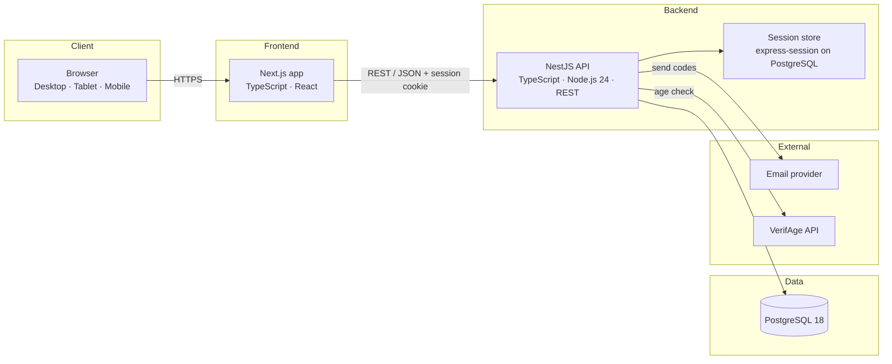

# Y — Product and Web Development Documentation

| | |
|---|---|
| **Product** | Y, a question-based social network (French UI) |
| **Document version** | 0.10 — draft, 2026-10-19 (contact messages and suspension reason, administrator two-factor login and re-authentication, sign-up, sign-in, notifications, trends, search, user-side reporting, blocking, profile editing and replies; DEC-080 to DEC-106; earlier: backend switched to NestJS and database to PostgreSQL, DEC-069 to DEC-074; account deletion, administration back-office, providers recorded, login events, audit log purge account and hash chain) |
| **Changelog** | 0.10 (2026-10-19): M0 steps 3.2, 3.9, 5.1, 7.5, 7.6 and 7.7 done (database health check, sessions on the `sessions` table, fictional seed; DEC-130 to DEC-132). 0.9 (2026-10-19): sections 7, 8.1, 8.2, 8.4, 9, 10, 14, 15 and 16 aligned with the code (status notes where the target is not built yet) (M0 steps 1 to 4.6, DEC-119 to DEC-128). 0.8 (2026-10-19): contact thread lifecycle and closing by lifting (DEC-116, DEC-117). 0.7 (2026-10-19): sections 3.1 to 3.4, R13, 12.5, 12.6 and new 12.7 updated for DEC-080 to DEC-106. |
| **Audience** | Product owner, designers, frontend and backend developers, reviewers |
| **Companion documents** | [`database/y-database.dbml`](database/y-database.dbml) (schema source), [`database/y-database-documentation.md`](database/y-database-documentation.md) (column reference) |

> **Status:** Draft. The product scope is defined by the design boards and this document (full list). The technical stack and API are proposals until the project is scaffolded. Decisions are recorded in section 19 and in the decision journal (`docs/decisions/journal-decisions.md`). The age check uses VerifAge (R7, DEC-019); its exact mechanism waits for the VerifAge API documentation (DEC-020).

---

## Contents

1. [Product overview](#1-product-overview)
2. [Product rules](#2-product-rules)
3. [Features and user flows](#3-features-and-user-flows)
4. [System architecture](#4-system-architecture)
5. [Technology stack](#5-technology-stack)
6. [Repository layout](#6-repository-layout)
7. [Local development](#7-local-development)
8. [Backend conventions](#8-backend-conventions)
9. [REST API](#9-rest-api)
10. [Database](#10-database)
11. [Frontend conventions](#11-frontend-conventions)
12. [Design system and UI rules](#12-design-system-and-ui-rules)
13. [Security and privacy](#13-security-and-privacy)
14. [Testing strategy](#14-testing-strategy)
15. [Configuration and environments](#15-configuration-and-environments)
16. [Deployment and operations](#16-deployment-and-operations)
17. [Git workflow and code review](#17-git-workflow-and-code-review)
18. [Roadmap](#18-roadmap)
19. [Open decisions](#19-open-decisions)
20. [Glossary](#20-glossary)

---

## 1. Product overview

### 1.1 Vision

Y encourages people to think before they answer. Users post short questions, react to them, and reply in conversation once a question gathers enough support. The product is a deliberate alternative to fast, reactive feeds.

### 1.2 Target users

Adults (18 and over) who want to discuss questions in French. Minors cannot create an account.

### 1.3 Core loop

1. A user posts a question (280 characters, text only).
2. Other users react: **J'aime**, **Pas d'accord** or **Y**.
3. When the question reaches **50 Y**, its conversation opens.
4. Users reply under the question, and reply reactions (J'aime, Pas d'accord) help surface the best answers.
5. Users follow each other, save questions, send private messages, and get notified.

### 1.4 Scope

**In scope:** accounts and authentication, account deletion with a 90-day window (R16), the feed, questions, replies, reactions, follows, saved questions (Signets), hashtags, trends and search, private messages, notifications, profiles, blocking (R14), settings, reports, and the administration back-office for the sole administrator (section 3.3).

**Out of scope for v1:** images other than the profile photo (avatar), video and GIFs, topic categories, mobile native apps, public API for third parties, muting of accounts. Conversation mute and archive are in scope (D5).

---

## 2. Product rules

These rules are binding for every feature. They come from explicit product decisions.

| # | Rule | Source |
|---|---|---|
| R1 | Questions are text only, up to 280 characters. | Design boards |
| R2 | Question reactions: `like` (J'aime), `dislike` (Pas d'accord), `y` (Y). Reply reactions: `like` and `dislike` only. | Design boards |
| R3 | A question's conversation opens when it reaches **50 Y**. Replies are accepted only after that. The threshold lives in configuration, not in code. | Design boards |
| R4 | Questions are grouped and sorted **by hashtags only**. Never add topic categories (for example "Philosophie · Tendance"). | Product decision, 2026-10-15 |
| R5 | **Feature parity**: Desktop, Tablet and Mobile expose the same features and actions. Layout adapts; features are never dropped. Overflow actions go into menus or modals. | Product decision, 2026-10-15 |
| R6 | **Y mirrors X (Twitter)**. Do not invent pages or flows X does not have. Prefer inline expansion over new pages ("Voir plus de réponses" loads more replies inline). The only exception is the share view `/questions/{id}`, reachable from a shared link and never from navigation (D4). | Product decision, 2026-10-15; D4 (proposed default) |
| R7 | Users must be **18 or older**. Signup rejects younger birth dates, and the age check goes through VerifAge. | Landing page |
| R8 | The UI is in **French**. Copy must not contain lorem ipsum or invented statistics. | Design boards |
| R9 | The UI is **light theme only**. | Design system |
| R10 | Notification times are relative ("il y a 2 h") for recent events. | Product decision, 2026-10-15 |
| R11 | Each user has **one reaction per question**: J'aime, Pas d'accord or Y. Changing it replaces the previous one. Removing it is allowed. | D1 (proposed default), 2026-10-16 |
| R12 | A question that does not reach 50 Y **stays forever** in the feed, trends and search, like any post. Nothing is archived or deleted automatically. It can keep receiving reactions. Replies open only at 50 Y (R3). | Decision of the product owner, 2026-10-16 |
| R13 | Only **`active` accounts** can post, react, reply, follow and save. Accounts in any other status (suspended, pending deletion, deleted, pending verification) are hidden from every feed, search, trend, suggestion, explore list and notification of other users (DEC-086). There is **no account-age condition and no quota** on actions. A user **may react to their own question**. Only `active` accounts count toward the 50 Y threshold. An open conversation **stays open** even if Y counts drop. | Decision of the product owner, 2026-10-16; DEC-086, 2026-10-19 |
| R14 | A user can **block** another account. Blocked content is hidden both ways, neither can follow, message or mention the other, and **blocking removes follows in both directions**. Blocking is in v1. | Decision of the product owner, 2026-10-16 (D12) |
| R15 | **Age check with VerifAge.** The provider is chosen (DEC-019). The verification mechanism is **on hold**: it waits for the VerifAge API documentation, requested from the provider by the owner (DEC-020). R7 stays binding. | Decision of 2026-10-16 |
| R16 | **Account deletion with a 90-day window.** On request, the account is suspended for deletion: it can no longer publish, react, reply or message. Its data is kept for 90 days, during which the user can cancel by logging back in. After 90 days, the account and its personal data are purged. This also serves as the GDPR right to erasure. | Decision of the product owner, 2026-10-16 (DEC-024) |
| R17 | **Moderation is handled by the sole administrator** through the back-office (section 3.3). Moderation actions (hide, remove, restore, suspend) are logged and reversible where stated. | Decision of 2026-10-16 (DEC-025) |
| R18 | **Email is used only for what matters.** Sent immediately: codes (signup, password, email change), password changed, email changed, deletion requested or cancelled, account suspended or reactivated, administrator login alert. Notifications (replies, reactions, follows, mentions) are **never** sent one by one: they are grouped into one **daily digest**, sent only when there is something new. The administrator's daily summary follows the same rule: sent only when reports are open. Brevo's free plan allows 300 e-mails a day (DEC-018). | Decision of the product owner, 2026-10-16 (DEC-041) |

---

## 3. Features and user flows

### 3.1 Feature list

| Area | Feature | Notes |
|---|---|---|
| Account | Signup with username, display name, date of birth, email, optional phone, password, terms acceptance | Display name is required and can be changed later (DEC-083). Phone optional, labelled « Téléphone (facultatif) » (D2, DEC-100). Date of birth is stored for the age check (VerifAge, R15) |
| Account | Email verification with a 6-digit code | Resend creates a new code |
| Account | Login with email address and password | No phone field: the form is labelled « Adresse e-mail » (DEC-094). Phone login is out of v1 (D2, DEC-007) |
| Account | Forgot password | Code by email |
| Account | Change email | Code sent to the new address |
| Account | Age check (18+) | VerifAge (R7, R15). Mechanism pending the API documentation (section 3.2) |
| Account | Logout with confirmation | |
| Feed | "Pour vous" tab (M2): most trending and most recent questions, from everyone | Definition in D17 |
| Feed | "Abonnements" tab (M4): followed accounts, newest first. "Pour vous" also gains followed accounts' trending and recent questions in M4 | Follows arrive in M4 |
| Feed | Post a question (280-character counter) | |
| Feed | Reactions: J'aime, Pas d'accord, Y, with counts | One reaction per user and question (R11). Y progress shown as 49/50 (R3). Only `active` accounts can react (R13) |
| Feed | Reply count, share, "⋯" menu (report, copy link, unfollow, block, delete own question) | Copy link opens the share view `/questions/{id}` (D4, R6). Report and block: section 12.7 (DEC-103, DEC-104) |
| Feed | Save to Signets | Button arrives with Signets in M4 (section 18.1) |
| Conversation | Reply box and replies once 50 Y is reached | Replies show reactions. Maximum 280 characters (D3). Own replies can be deleted. Reply composer: section 12.7 (DEC-106) |
| Conversation | "Voir plus de réponses" | Loads more replies inline |
| Conversation | Mention with @ in a question or a reply | Creates a mention notification (DEC-089) |
| Explore | Trends by hashtag with question counts | Ranked by reactions in the last 24 hours, labelled « sur 24 h » (DEC-091, DEC-046) |
| Explore | Popular questions | |
| Explore | Search questions, hashtags and users, with typing suggestions and clear button | Placeholder « Rechercher une question, un compte ou un #hashtag » (DEC-099, DEC-022) |
| Explore | Search and hashtag results screen | Hashtag results |
| Explore | Suggestions to follow | |
| Profile | Own profile and other profiles | Follow / following state |
| Profile | Followers and following lists | |
| Profile | Block and unblock an account | Blocked accounts are hidden both ways and cannot message or follow each other (R14). Confirmation before blocking (DEC-104) |
| Profile | Edit profile: display name (50), bio (160), handle (30, unique regardless of case), avatar | Modal on desktop and tablet, full screen on mobile. Bio maximum 160 characters (D3). The phone number is not editable in v1. The profile photo (avatar) is in v1; there is no profile banner in v1 (DEC-107). Email changes stay in settings and use the code flow (section 3.2). Details: section 12.7 (DEC-105) |
| Signets | Saved questions with a sort selector ("Date de la question" / "Date d'enregistrement") | |
| Signets | Empty state, "Retiré · Annuler" toast, clear all | |
| Notifications | Reply to a question, conversation opened, reactions (grouped), follow, mention | Mark all as read |
| Notifications | Notification settings, per notification type. Seven types are stored; the « Réactions » screen groups like, dislike and y into one setting | Decision D7 (proposed default). No change to the data model (DEC-090) |
| Messages | Conversation list with unread badge | |
| Messages | Conversation view with read receipt "Vu" | |
| Messages | New message | |
| Messages | Shared question card | |
| Messages | Message requests from people not followed | |
| Messages | Conversation options (mute, archive) | Included in v1 (D5, proposed default) |
| Settings | Account, change password, help center, about, logout, delete account | Account deletion: 90-day window, cancellable by logging back in (R16, section 3.2). Needs legal review |
| Settings | Export of personal data | Not in v1 (to decide; see the privacy policy) |
| Moderation | Report a question or a reply | Fixed list of reasons (D6). Reporter never shown to the author. Reason picker and detail for « autre »: section 12.7 (DEC-103) |
| Administration | Back-office: report queue, hide, remove, restore, suspend, reactivate, deletion queue, audit log | Sole administrator, separate area, two-factor login (section 3.3, R17) |

### 3.2 User flows

**Signup**
1. User enters the account details on the signup screen. The display name is required (DEC-083).
2. The API validates the data and creates the account with status `pending_verification`.
3. A 6-digit code is emailed. The user enters it on the code screen.
4. On success, the account becomes `active`. On error, the user can resend the code.
5. **Age check (VerifAge).** The provider is chosen. The exact flow is defined once the VerifAge API documentation is available (R7, R15, DEC-019, DEC-020).

**Login**
1. User enters email address and password (DEC-094).
2. The API checks the credentials and opens a session cookie.
3. Failed attempts are counted and limited (section 13).

**Forgot password**
1. User requests a reset. A code is emailed.
2. User enters the code and a new password. The code is marked consumed.

**Change email**
1. User enters the new address in settings. A code is sent to that address.
2. On validation, `users.email` is updated.

**Question lifecycle**
1. User posts a question. It appears in the feed.
2. Reactions change the counters. Each user has one reaction per question (R11). Only `active` accounts can react (R13).
3. At 50 Y, `conversation_opened_at` is set and a notification is sent. The conversation stays open even if Y counts drop (R13).
4. A question that does not reach 50 Y stays in the feed, trends and search with no time limit (R12). It can keep receiving reactions, and replies stay closed until 50 Y.
5. Replies become possible once the conversation is open. Replies can be reacted to and mentioned.

**Block**
1. User A blocks user B from the "⋯" menu of a question or of B's profile, after a confirmation (DEC-104). B's content is hidden from A, and A's content is hidden from B.
2. Neither can follow, message or mention the other (R14).
3. Blocking removes existing follows in both directions (R14).

**Message request**
1. User A writes to user B, who does not follow A. The conversation is created with `request_status = pending`.
2. B accepts, or declines. Accepted conversations behave like normal conversations.

**Account deletion (R16)**
1. The user asks for deletion in settings and enters their password. `status` becomes `pending_deletion`, `deletion_requested_at` is set, and `deletion_purge_at` is set to 90 days later.
2. The account is signed out. It can no longer publish, react, reply, follow, save or message, and it cannot be followed. Its questions and replies are hidden from the public at once through the account status, not `deleted_at`, which is kept for deletion by the author and for the purge (DEC-087).
3. For 90 days the user can cancel by logging back in: the status returns to `active` and the hidden content comes back. Proposed default.
4. A daily job purges accounts whose `deletion_purge_at` has passed. In one transaction per account: personal data is removed (email replaced by a unique placeholder, phone, password hash, bio, avatar and birth date cleared, display name replaced by "Compte supprimé"), the handle is replaced by a placeholder, the content is erased as in DEC-067, reactions and counters are updated, follows and blocks are removed, login events are deleted, and the account is set to `deleted`. The purge is logged.
5. A request for erasure (GDPR, right to be deleted) follows the same path. Some data may be kept where the law requires it.

**Moderation (R17)**
1. A user reports a question or a reply from the "⋯" menu, choosing a reason from the fixed list. The report is `open`.
2. The administrator sees it in the back-office queue, with the number of reports on the same content.
3. The administrator decides: no action, hide, remove, or suspend the account. A reason is required for every decision (DEC-088), and the decision is logged.
4. Hidden or removed content is excluded from every public surface. Restoring a hidden or removed item is possible within 30 days. A content removal by the author is not restorable.
5. The reporter is never revealed to the author.

### 3.3 Administration back-office

A separate area for the sole administrator. It is not linked from the public site.

**Access**
- Served on a separate route, `/admin`, and an API under `/api/v1/admin/`. The role is checked on the server for every request. Non-administrators get a 404 (not a 403, so the area is not discoverable).
- Not indexed: `noindex` and an entry in `robots.txt`.
- Login requires the password **and** a time-based one-time code (TOTP, free open-source library). The TOTP secret is stored encrypted, and a code cannot be reused. Ten single-use backup codes are generated, and stored hashed (DEC-082).
- Admin sessions are shorter: 30 minutes of inactivity, 8 hours at most from sign-in, and no "remember me" (DEC-036, DEC-082).
- Re-authentication (password and TOTP within the last 10 minutes, kept in the session) is required for suspending an account, lifting a suspension, removing content, revealing an email address, and starting a purge (DEC-088). The "Retirer" dialog asks for it (DEC-102).
- The back-office is desktop only. The feature parity rule (R5) does not apply to it (DEC-076).
- After 5 failed logins the account is locked for 15 minutes. Each successful admin login sends an e-mail alert to the administrator.
- Admin pages load no third-party scripts and no analytics, and are served with `Cache-Control: no-store`.

**Screens (MVP)**
- **Report queue:** open reports, oldest first, with filters by status, reason and content type. A content reported several times appears once, with its count.
- **Content view:** the content, its author, and the report history.
- **Account view:** handle, display name, status, role, sign-up date, counts of reports and of hidden or removed content, and the full action history. The email address is masked by default and revealed only by a logged action. The status filter lists every status, including pending verification and deleted (DEC-101).
- **Actions:** dismiss a report, hide, remove, restore, suspend or reactivate an account, and start a deletion. Each of these decisions needs a reason, except "marked as handled" on a contact message (DEC-088). Re-authentication applies as stated in "Access" above.
- **Deletion queue:** accounts waiting for purge, with the purge date.
- **Dashboard:** open reports, age of the oldest open report, average time to handle a report over 30 days, accounts waiting for deletion.
- **Audit log:** read-only, filterable by target and by actor.
- **Daily summary e-mail:** sent through Brevo only when reports are still open. Not one e-mail per report.

**Data shown by default**

| Data | Default | Hidden |
|---|---|---|
| Report | Date, reason, status, target, author's handle | Reporter's identity (revealed only by a logged action) |
| Account | Handle, display name, status, role, sign-up date, report counts | Email (masked, e.g. `j***@d***.fr`); phone never; birth date reduced to "adult yes/no"; password never |
| Login | Last login, number of sessions | IP address and user agent (hashed only) |
| Private messages | Nothing | Not accessible in v1 (not reportable) |

**Audit log**
- Append-only: the application database user can only read and insert in it. A separate maintenance account deletes old rows during the retention purge (DEC-059).
- Records: who, when, what, target, the reason for sensitive actions, the before and after values of changed fields only, and the result (`ok`, `failed` or `refused`, DEC-085).
- Never recorded: passwords, codes, session identifiers, full email addresses.
- Each entry stores `prev_hash`, a keyed hash (HMAC-SHA-256, server secret kept out of Git) of the previous entry. A deleted or altered entry in the middle of the log breaks the chain and is detected. Entries removed by the retention purge are expected: the check starts at the oldest entry kept (DEC-063).
- The chain is computed with the exact encoding of the database reference (`admin_audit_log`, DEC-064, DEC-128).
- Retained 12 months for actions and 6 months for administrator logins (DEC-027, DEC-059). Ordinary users' login attempts are kept 6 months in `login_events` (DEC-060).

**Later (not in the MVP)**
- A distinct moderator role, a formal appeal process for sanctioned users, reports on accounts, messages or profiles, advanced search, CSV export of the logs, and an export of personal data from the account view.

### 3.4 Contacting the administrator (suspended accounts)

- A suspended account sees the banner "Votre compte est suspendu" with the reason (DEC-077, DEC-081). The link "Contacter l’administrateur" opens a contact form (1,000 characters maximum). Only one message can be open at a time (proposal, DEC-078): an account has at most one thread with status `new` (DEC-080). A thread can only be created for a suspended account.
- Each contact thread has a unique reference of the form `CNT-AAAAMMJJ-NNNN`, for example `CNT-20261019-0001` (DEC-080).
- The message goes to the contact inbox of the back-office, which is named "Tribunal des bannis" in the menu and as the title of the queue. The route stays `/admin/support` (DEC-096). It is not a private message and does not use the messaging feature (private messages are in the v1 scope, section 1.4).
- The administrator replies by e-mail to the address of the account. Each reply and each status change is recorded in the audit log (`contact.reply`, `contact.close`, DEC-085).
- Statuses: new, replied, closed, shown in the interface as Nouveau, Répondu and Traité. A message is closed when the administrator marks it as handled. This decision needs no reason (DEC-088). A closed thread never reopens: the user's next message opens a new thread (DEC-116). The administrator cannot reply to a closed thread (DEC-118).
- A user's message on a `replied` thread joins the same thread, and its status returns to `new` (DEC-116).
- Lifting a suspension requires a reason, sends an e-mail to the user, and is recorded in the audit log (DEC-077, DEC-078, DEC-088). It also closes the open thread (DEC-116). A new suspension reopens the thread that the lifting closed, marked by `closed_by_lift` (DEC-116, DEC-117).
- Storage is defined by DEC-080: a thread table (`support_threads`) holds the reference, status and closing data, and a message table (`support_messages`) holds the messages from the user and from the administrator. A purge of the account deletes its threads (DEC-024). The endpoints are not yet in the API reference (section 9).

---

## 4. System architecture



**Key decisions**

- The frontend and backend are **separate applications** that talk through a versioned REST API (`/api/v1`).
- The backend is the **only** component that touches the database. The frontend never queries PostgreSQL.
- Authentication uses an **HTTP-only, Secure, SameSite session cookie**, not tokens in local storage.
- Long-running work (sending email, age checks) runs outside the request when possible.

---

## 5. Technology stack

| Concern | Choice | Version guidance | Why |
|---|---|---|---|
| Backend language | TypeScript | Strict mode | One language for the backend and the frontend. Types are shared through the OpenAPI document (DEC-069). |
| Backend runtime | Node.js | **24 LTS** (active LTS). Pin the latest 24.x patch at scaffold (M0). Node.js 26 becomes LTS on 28 October 2026; revisit then | Current LTS line. Required by NestJS and the frontend tools. |
| Backend framework | NestJS | **11.x**, latest 11.x patch at scaffold (M0). NestJS 12 is adopted once it is stable (DEC-069) | Modules, dependency injection and decorators, close to the feature-and-layer structure of section 8. |
| HTTP platform | Express | Default of NestJS | Cookie sessions and middleware. |
| Validation | class-validator, class-transformer | Current, pinned at scaffold | Input rules on request DTOs, through a global `ValidationPipe`. |
| Sessions | express-session, with an application store on the `sessions` table | Current, pinned at scaffold | Sessions stored in PostgreSQL (DEC-071). Redis later if needed. |
| Persistence | Prisma ORM | **7.x**. Pin the CLI with `prisma@7`: Prisma 8 changes the commands and is not used until it is stable (DEC-072) | Typed client generated from `schema.prisma`. |
| Complex queries | Prisma `$queryRaw` (typed), or Kysely | Optional, from milestone M4 | Feed, trends and counters with hand-written SQL. |
| Migrations | Prisma Migrate | Matches Prisma 7 | Plain SQL migrations in `backend/prisma/migrations/`, applied by `prisma migrate deploy` (DEC-072). |
| Database | PostgreSQL | **18.6**, pinned by digest at scaffold (DEC-070, DEC-126) | Supports the schema: `uuid`, `timestamptz`, `json`, expression indexes, full-text search. |
| Password hashing | argon2 (Argon2id) | Current, pinned at scaffold | Section 13. |
| Security headers | Helmet | Current, pinned at scaffold | Standard HTTP security headers. |
| CSRF | Double-submit token (for example the `csrf-csrf` package) | Current, pinned at scaffold | Section 13. |
| Rate limiting | @nestjs/throttler | Current, pinned at scaffold | Section 9.4. Login counters are kept in the database (DEC-040). |
| API docs | @nestjs/swagger | Matches NestJS | Generates OpenAPI from decorators and DTOs. |
| Health | @nestjs/terminus | Matches NestJS | Health endpoint `/health`. |
| Logs | pino (nestjs-pino) | Current, pinned at scaffold | Structured JSON logs with a request ID. |
| Scheduled jobs | @nestjs/schedule | Matches NestJS | Retention jobs (section 13, DEC-068). |
| Package manager | npm | With `package-lock.json`, pinned at scaffold | Same tool as the frontend. |
| Backend tests | Jest, Supertest, Testcontainers for Node (PostgreSQL module) | Current, pinned at scaffold | Unit tests with Jest, HTTP tests with Supertest, real PostgreSQL in integration tests (DEC-073). |
| Frontend framework | Next.js (App Router) | **16.2.11** or later (security release of 20 July 2026). Pin at scaffold (M0) | Server rendering for public pages. |
| Frontend runtime | Node.js | Current LTS, pinned at scaffold (M0) | Required by Next.js 16 and the frontend test tools. |
| Frontend language | TypeScript | Strict mode | Type safety shared between UI and API types. |
| UI | React | Bundled with Next.js | |
| Styling | CSS Modules or Tailwind CSS | To decide (section 19) | Must reproduce the design tokens (section 12). |
| Frontend tests | Vitest, Testing Library | Current | Components and hooks. |
| End-to-end tests | Playwright | Current | Critical flows on all three breakpoints. |
| Containers | Docker, Docker Compose | Current | Local PostgreSQL and production images. |
| CI | GitHub Actions | — | Build, test and lint on every pull request. |
| E-mail | Brevo (free plan), official SDK | 300 e-mails a day; API and SDK included | Codes, security e-mails and the daily digest (R18, DEC-018, DEC-041). |

---

## 6. Repository layout

Proposed monorepo layout:

```
y/
├── backend/                 # NestJS application (TypeScript, Node.js 24)
│   ├── src/                 # feature modules (section 8)
│   │   ├── main.ts
│   │   ├── app.module.ts
│   │   └── common/          # errors, pagination, config, database, sessions
│   ├── prisma/
│   │   ├── schema.prisma    # data model, written from the DBML (section 10)
│   │   └── migrations/      # SQL migrations, never edited once applied
│   ├── test/                # end-to-end tests (Supertest, Testcontainers)
│   ├── package.json
│   └── tsconfig.json
├── frontend/                # Next.js application (TypeScript)
│   ├── app/                 # routes (App Router)
│   ├── components/          # UI components
│   ├── lib/                 # API client, utilities
│   ├── styles/              # design tokens
│   └── package.json
├── docs/
│   ├── README.md                          # index of all documentation
│   ├── y-product-and-web-documentation.md # this document
│   ├── stack-expliquee-simplement.md      # plain-language stack overview (French)
│   ├── database/
│   │   ├── y-database.dbml                # schema source of truth
│   │   └── y-database-documentation.md    # column reference
│   ├── decisions/
│   │   └── journal-decisions.md           # decision journal (DEC-xxx)
│   ├── legal/                             # legal drafts (mentions, terms, privacy)
│   ├── plans/
│   │   └── M0-PLAN.md                     # step-by-step plan for M0
│   └── reports/
│       └── RAPPORT-AUDIT-Y.md             # audit snapshot of 2026-10-16
├── design/                  # Y design source: boards, logos, briefs (see its STATUS.md)
├── archive/                 # kept for history (old Figma exports, see archive/README.md)
├── docker-compose.yml       # local PostgreSQL
└── .github/workflows/       # CI
```

Note: the design folder is `design/` (decided in M0, step 0.2), inside `y/`. The design system is shared across sites and lives outside `y/`, in `design-system/` at the project root (DEC-075). The project root also holds `personal-website/` and `my-mock-micro-investor/` (DEC-075).

---

## 7. Local development

> **Status:** the backend runs locally (M0 steps 1 to 4.6 are done). The frontend is not scaffolded yet, so its commands are the target setup.

**Prerequisites**
- Node.js 24 LTS and npm
- Docker, with the Compose plugin (for the PostgreSQL container and for the end-to-end tests, which start their own container)

**Start the database**
```bash
docker compose up -d postgres   # PostgreSQL 18.6 on 127.0.0.1:5434 (DEC-125, DEC-126)
```

**Start the backend** (port 8080)
```bash
cd backend
cp ../.env.example .env         # then fill the secret keys locally; they are empty in the example; never commit .env
npm install
set -a; . ./.env; set +a        # the Prisma CLI reads DATABASE_URL from the environment
npx prisma migrate deploy       # applies the migrations to the local database
npm run build && npm start      # there is no watch mode yet
npm run db:seed                 # optional: fictional users, hashtags, questions and replies (refuses production)
```

The backend refuses to start when a required key is missing, and prints only the key names (section 15.2).

**Start the frontend** (port 3000, not scaffolded yet)
```bash
cd frontend
npm install
npm run dev
```

**Run the checks**
```bash
cd backend && npm run lint && npm test && npm run test:e2e   # unit tests, then end-to-end and migration tests (Docker must run)
cd frontend && npm run lint && npm test                      # once the frontend exists
```

**Useful URLs (local)**
- App: http://localhost:3000 (once the frontend exists)
- API: http://localhost:8080/api/v1
- Health: http://localhost:8080/health
- API docs: http://localhost:8080/api/docs (enabled locally and in staging, disabled in production)

---

## 8. Backend conventions

### 8.1 Package structure

Organize by feature, then by layer. The tree is the target. Today `src/` holds `common/` (CSRF, logging, Problem Details, audit chain, sessions), `config/`, `database/` (Prisma service, generated client, seed), `health/`, `app.controller.ts`, `app.module.ts`, `configure-app.ts` and `main.ts`. A feature folder is created when its step starts (owner decision, 2026-10-19).

```
src/
├── auth/            # signup, login, codes, password reset, email change
├── age/             # VerifAge integration
├── users/           # profiles, follows
├── questions/       # posts, feed, counters
├── replies/         # replies and reply reactions
├── reactions/       # question reactions
├── hashtags/        # hashtags, trends, search
├── bookmarks/       # Signets
├── messaging/       # conversations, messages, requests
├── notifications/   # events, read state, preferences
├── moderation/      # reports
├── administration/  # back-office (section 3.3)
└── common/          # errors (Problem Details), logging, CSRF, audit chain, pagination, database, sessions
```

Each feature module contains:
- `<feature>.controller.ts` — REST controllers
- `dto/` — request and response types
- `<feature>.service.ts` — business logic and transactions
- `<feature>.repository.ts` — the only file of the feature that calls Prisma
- `<feature>.module.ts` — NestJS module wiring

### 8.2 Layer rules

- Controllers do **not** contain business logic. They validate input, call a service, and map the result.
- Services own transactions (`prisma.$transaction`) and enforce product rules (section 2).
- Prisma models never leave the repository layer. Controllers return DTOs.
- Repositories are the only place that writes queries.
- The Prisma client is `PrismaService` (M0 step 3.2). Only repositories and the session store query the database through it.

### 8.3 Coding rules

- Constructor injection only, as NestJS does by default. No property injection.
- Request DTOs are classes with class-validator decorators. Response types are `readonly` types. No `any`.
- Use the configured threshold (`Y_CONVERSATION_THRESHOLD`, read through `ConfigService`), never a hard-coded `50`.
- Counters (`like_count`, `y_count`, `follower_count`, …) are updated in the **same transaction** as the change they count. A scheduled reconciliation job corrects drift.
- Times are stored and returned in UTC (ISO 8601). The frontend formats them for French users.
- Logs never contain passwords, codes, session IDs or full email addresses.

### 8.4 Errors

All errors use **RFC 9457 Problem Details** (`application/problem+json`), produced by one global exception filter:

```json
{
  "type": "about:blank",
  "title": "Unprocessable Entity",
  "status": 422,
  "detail": "The code is incorrect or has expired.",
  "instance": "/api/v1/auth/signup/verify",
  "requestId": "2f1c0e9a-6b3d-4c1e-9f0a-7d2b8e4c5a11"
}
```

As built today, `type` is `about:blank` until specific error types are defined, and `title` is the standard HTTP reason phrase. `requestId` is the ID of the request's log line (M0 step 3.8). A server error (status 500) returns `detail: "Unexpected error."`; its message is only logged.

Use these status codes consistently:

| Status | When |
|---|---|
| 400 | Malformed request |
| 401 | Not logged in, or wrong credentials at login (generic message, section 9.4) |
| 403 | Logged in but not allowed |
| 404 | Resource not found, or hidden (for example a deleted question) |
| 409 | Conflict, such as an email or handle already in use |
| 422 | Valid format, failed business rule (wrong code, under 18, not 50 Y yet) |
| 429 | Too many attempts |

---

## 9. REST API

Base path: `/api/v1`. JSON everywhere. Authentication by session cookie. Mutations require the CSRF token.

> **Status (2026-10-19):** this section is the target contract. Today the API has `GET /api/v1/status` and `GET /health` only. The CSRF protection is in place: a double-submit cookie `y_csrf`, sent back in the `X-CSRF-Token` header on every mutation. No mutation route exists yet.

### 9.1 Conventions

- Resource names are plural nouns in kebab-case. Exceptions are listed below.
- Reactions are **idempotent** `PUT`/`DELETE` on a sub-resource, so clicking twice does not double-count. Marking a conversation as read is also a `PUT`.
- **Every list endpoint** uses cursor pagination: `?cursor=…&limit=…`. Default `limit` is 20, maximum 50. Responses have the envelope `{ "items": [...], "nextCursor": "…" | null }`. Offsets are not used. This applies to the feed, replies, followers and following, bookmarks, notifications, conversations, messages, hashtags, search, popular questions, trends, suggestions, blocks and admin lists.
- **Idempotency:** every `POST` that creates a resource (questions, replies, messages, conversations, reports, blocks) accepts an `Idempotency-Key` header. A repeated key returns the first result instead of creating a second item.
- **Status codes:** `201` on creation with a `Location` header, `204` on deletion without body, `200` on other successful mutations. Full list in section 8.4.
- **Times:** ISO 8601 in UTC. **Field names:** camelCase in JSON, everywhere (including `lastMessageAt`).
- **Reserved handles:** `me`, `admin`, `api`, `login`, `signup`, `settings`, `explore`, `home`, `messages`, `notifications`, `bookmarks`, `hashtags`, `suggestions`, `support`, `y`. A handle cannot use a reserved word. A handle uses only ASCII letters, digits and underscore (DEC-061).
- **Exceptions to plural nouns:** `/feed`, `/search`, `/auth/*`, `/admin/*` (sections), `/age-verification`, and the `me` resource (`/users/me`).
- **OpenAPI:** the OpenAPI document (`openapi.yaml`) is generated from the code (@nestjs/swagger). Today it is served at `/api/docs` (not in production). The contract is exported to `backend/openapi.yaml` with `npm run openapi:export` and committed. `npm run openapi:check` fails on a breaking change (openapi-diff) and when the file is out of date (M0 step 7.6). The CI run comes with step 9. It is required, not optional.
- **Versioning:** a breaking change creates `/api/v2`. The old version is marked with `Deprecation` and `Sunset` headers before removal.

### 9.2 Endpoints

Target list. Each endpoint arrives with its milestone. `/health` is outside the `/api/v1` prefix.

**Authentication**

| Method | Path | Purpose |
|---|---|---|
| POST | `/auth/signup` | Create an account (status `pending_verification`) |
| POST | `/auth/signup/verify` | Validate the signup code |
| POST | `/auth/signup/resend` | Send a new signup code |
| POST | `/auth/login` | Log in with email and password (phone login is out of v1, D2) |
| POST | `/auth/logout` | End the session |
| POST | `/auth/password-reset/request` | Send a reset code |
| POST | `/auth/password-reset/confirm` | Validate the code and set a new password |
| POST | `/auth/email-change/request` | Send a code to the new address |
| POST | `/auth/email-change/confirm` | Validate the code and switch the email |
| POST | `/age-verification` | Start the VerifAge check. Returns the URL to redirect the user to (provider chosen, DEC-019; exact mechanism pending the API documentation, DEC-020) |
| POST | `/webhooks/verifage` | Result sent by VerifAge, server to server. Signature checked before any change. Not callable by users (DEC-020, proposed) |

**Account and profiles**

| Method | Path | Purpose |
|---|---|---|
| GET | `/users/me` | Current user |
| PATCH | `/users/me` | Update display name, bio, handle |
| PUT | `/users/me/password` | Change password. Body `{currentPassword, newPassword}`; the current password is required |
| PUT | `/users/me/email` | Start an email change (sends a code to the new address). Email is not part of `PATCH /users/me` |
| GET | `/users/{handle}` | Public profile |
| GET | `/users/{handle}/followers` | Followers list (cursor) |
| GET | `/users/{handle}/following` | Following list (cursor) |
| PUT | `/users/{handle}/follow` | Follow (idempotent) |
| DELETE | `/users/{handle}/follow` | Unfollow |
| GET | `/users/suggestions` | Suggestions to follow (cursor) |
| GET | `/users/{handle}/questions` | Questions published by a user (cursor). Hidden and deleted questions are excluded |
| PUT | `/users/{handle}/block` | Block a user (idempotent). Removes follows in both directions (R14) |
| DELETE | `/users/{handle}/block` | Unblock a user |
| GET | `/users/me/blocks` | Blocked accounts (cursor) |

**Feed and questions**

| Method | Path | Purpose |
|---|---|---|
| GET | `/feed?tab=for-you\|following&cursor=…` | Home feed. `for-you` from M2 (D17). `following` from M4 |
| POST | `/questions` | Post a question (280 characters max) |
| GET | `/questions/{id}` | One question (used for shared links) |
| DELETE | `/questions/{id}` | Delete own question (soft delete) |
| PUT | `/questions/{id}/reactions/{kind}` | Add a reaction: `like`, `dislike` or `y` |
| DELETE | `/questions/{id}/reactions/{kind}` | Remove a reaction |
| PUT | `/questions/{id}/bookmark` | Save to Signets |
| DELETE | `/questions/{id}/bookmark` | Remove from Signets |
| GET | `/bookmarks?sort=question-date\|saved-date&cursor=…` | Signets list |
| DELETE | `/bookmarks` | Clear all saved questions |

**Replies**

| Method | Path | Purpose |
|---|---|---|
| GET | `/questions/{id}/replies?cursor=…` | Replies, paginated ("Voir plus de réponses") |
| POST | `/questions/{id}/replies` | Reply. Refused with 422 until the conversation is open |
| DELETE | `/replies/{id}` | Delete own reply (soft delete) |
| PUT | `/replies/{id}/reactions/{kind}` | `like` or `dislike` |
| DELETE | `/replies/{id}/reactions/{kind}` | Remove a reaction |

**Hashtags, trends and search**

| Method | Path | Purpose |
|---|---|---|
| GET | `/hashtags/trending` | Trend list with question counts |
| GET | `/hashtags/{name}/questions?cursor=…` | Questions for one hashtag |
| GET | `/search?q=…` | Search questions and users |
| GET | `/search/suggestions?q=…` | Typing suggestions |
| GET | `/questions/popular` | Popular questions |

**Messages**

| Method | Path | Purpose |
|---|---|---|
| GET | `/conversations` | Inbox, sorted by `last_message_at` |
| POST | `/conversations` | Start a conversation with a user |
| GET | `/conversations/{id}/messages?cursor=…` | Messages |
| POST | `/conversations/{id}/messages` | Send a message (optionally with `sharedQuestionId`) |
| PUT | `/conversations/{id}/read` | Update `last_read_at` (idempotent) |
| GET | `/conversations/requests` | Pending message requests received (cursor) |
| POST | `/conversations/{id}/accept` | Accept a message request |
| POST | `/conversations/{id}/decline` | Decline a message request |
| PATCH | `/conversations/{id}` | Mute or archive (D5, included in v1) |

**Notifications**

| Method | Path | Purpose |
|---|---|---|
| GET | `/notifications?cursor=…` | Notifications, grouped for display |
| POST | `/notifications/read-all` | Mark all as read |
| GET | `/notification-preferences` | Current preferences |
| PUT | `/notification-preferences/{type}` | Enable or disable a type |

**Moderation**

| Method | Path | Purpose |
|---|---|---|
| POST | `/reports` | Report a question or a reply |

**Account deletion (R16)**

| Method | Path | Purpose |
|---|---|---|
| PUT | `/users/me/deletion` | Request deletion. Requires the current password. Starts the 90-day window |
| DELETE | `/users/me/deletion` | Cancel a deletion request, while the window is open |

**Administration (R17, role `admin` required, CSRF token on mutations)**

| Method | Path | Purpose |
|---|---|---|
| GET | `/admin/reports?status=open&cursor=…` | Report queue |
| GET | `/admin/reports/{id}` | Report and the content it targets |
| PUT | `/admin/reports/{id}/decision` | Body `{decision, note}`. Sets the report to `resolved` or `dismissed` |
| PUT | `/admin/questions/{id}/moderation` | Body `{status, reason}`: `visible`, `hidden` or `removed` |
| PUT | `/admin/replies/{id}/moderation` | Same as above, for replies |
| GET | `/admin/users?q=…&status=…&cursor=…` | Search by handle or email |
| GET | `/admin/users/{id}` | Account view |
| PUT | `/admin/users/{id}/status` | Body `{status, reason}`: `active` or `suspended`. Suspension revokes the sessions |
| GET | `/admin/audit-logs?target_type=…&target_id=…&cursor=…` | Audit log, read-only |
| GET | `/admin/deletions?cursor=…` | Accounts waiting for purge |

### 9.3 Example: reaction

```http
PUT /api/v1/questions/0f8c…/reactions/y
Cookie: SESSION=…; y_csrf=…
X-CSRF-Token: …
```

```http
HTTP/1.1 200 OK
Content-Type: application/json

{
  "questionId": "0f8c…",
  "counts": { "like": 124, "dislike": 12, "y": 50 },
  "viewerReactions": ["y"],
  "yThreshold": 50,
  "conversationOpen": true
}
```

The same `yThreshold` and `conversationOpen` fields appear in every question payload, so no screen hard-codes the value 50.

### 9.4 Rate limits (security only)

Today the only limit is global: 120 requests per minute per IP address (value chosen during M0 step 3, not written in the plan). The per-endpoint limits below arrive with the auth module.

Rate limits protect accounts and codes. Content actions (posting, reacting, replying, messaging, following, blocking) have **no quota** (R13). Limits return `429` with a `Retry-After` header. Values are proposed defaults (DEC-040).

| Endpoint | Limit (proposed) |
|---|---|
| `POST /auth/login` | 5 failures per account in 15 minutes, then the account is locked for 15 minutes. 20 attempts per IP in 15 minutes |
| `POST /auth/signup` | 5 per IP per hour |
| `POST /auth/signup/verify`, `POST /auth/password-reset/confirm`, `POST /auth/email-change/confirm` | 5 wrong codes per code, then the code is invalidated (D8). 20 attempts per IP per hour |
| `POST /auth/signup/resend`, `POST /auth/password-reset/request`, `POST /auth/email-change/request` | 3 per account per hour, 10 per IP per hour |
| `POST /admin/*` login | 5 failures, then a 15-minute lock, and an alert e-mail (DEC-036) |

**Enumeration protection:** the signup response and the password-reset response do not reveal whether an email address already has an account. The response is the same in both cases (proposed).

**Login errors:** a wrong password returns `401` with the generic message "Identifiants incorrects". Account existence is not revealed.

---

## 10. Database

- **Schema source of truth:** [`database/y-database.dbml`](database/y-database.dbml). Column reference: [`database/y-database-documentation.md`](database/y-database-documentation.md).
- **28 tables** (DBML version 0.9), grouped into accounts, sessions, social, content, messaging, activity, moderation and administration. Version 0.2 added `blocks` (R14) and the Spring Session tables. Version 0.3 adds `admin_audit_log` (R17). Version 0.4 adds `login_events` (DEC-060). Version 0.5 adds `users.terms_version` (DEC-062), `admin_audit_log.prev_hash` (DEC-063), the encoding rules of the hash chain (DEC-064) and a single unique index on `handle` (DEC-061). Version 0.6 moves the schema from MySQL to PostgreSQL (DEC-070) and replaces the Spring Session tables with one `sessions` table (DEC-071). The handle index is now a unique index on `lower(handle)`.
- **Migrations:** Prisma Migrate (DEC-072). The initial migration creates the schema from the DBML. Every later change is a new migration folder. Never edit a migration that has been applied anywhere.
- **Identifiers:** `uuid` values generated by the database with `gen_random_uuid()`.
- **Time:** `timestamptz(3)`, stored in UTC.
- **Deletion:** questions and replies are soft-deleted (`deleted_at`).
- **Indexes:** every foreign key used in a list query has an index (see the column reference).

### 10.1 Migration workflow

1. Change `y-database.dbml` first and review it.
2. Write the Prisma migration (SQL) that makes the same change, and update `schema.prisma`.
3. Update the repository and the service that uses it.
4. Add an integration test that runs the migrations on a fresh PostgreSQL (Testcontainers).
5. Update `y-database-documentation.md` by hand so that its column lists and notes match the DBML.

### 10.2 Migration rules

- **Never edit an applied migration.** A migration is applied once it has run on any environment (local, staging or production). A mistake in it is fixed by a new migration.
- **Forward-only.** There is no down migration. A rollback is a new corrective migration that reverses the change (DEC-056).

### 10.3 Database roles

Three roles are created once per environment, after the migrations, by `backend/database/roles.sql` (DEC-129):

| Role | Used by | Rights |
|---|---|---|
| `y_app` | The application (`DATABASE_URL`) | Reads and writes its tables. `admin_audit_log` and `login_events` are append-only: `SELECT` and `INSERT` only. Cannot change `_prisma_migrations`. |
| `y_maintenance` | The purge jobs (`DATABASE_MAINTENANCE_URL`) | `SELECT` and `DELETE` on `admin_audit_log` and `login_events`, and nothing else. The other purges get their rights when their job is built (M1 to M7). |
| `y_backup` | The backup job (M0 step 11) | Reads every table, writes none. |

- Passwords are passed on the command line (`psql -v app_password=…`). They are never stored in the repository.
- Tables created by later migrations get the application and backup grants by default, when the migration runs as the role that ran the script. A new append-only table must remove `UPDATE` and `DELETE` from `y_app` in its own migration.
- Migrations need a role that owns the schema. Locally that is `y`. A separate owner role for staging and production is set up at M0 step 10.
- In staging and production, `DATABASE_URL` uses `y_app`, not the owner.

---

## 11. Frontend conventions

### 11.1 Routes

Route names are English. UI labels stay in French.

| Route | Access | Screen |
|---|---|---|
| `/` | Guest | Landing page (same states as the app feed) |
| `/login` | Guest | Login |
| `/signup` | Guest | Signup |
| `/signup/verify` | Guest, pending account | Enter the 6-digit code |
| `/forgot-password` | Guest | Reset request and code entry |
| `/home` | User | Feed. Tab "Pour vous" (M2), tab "Abonnements" added in M4 |
| `/explore` | User | Trends, popular questions, search (`?q=`) |
| `/hashtags/[name]` | User | Questions for one hashtag |
| `/notifications` | User | Notifications |
| `/messages` | User | Inbox |
| `/messages/[conversationId]` | User | One conversation |
| `/messages/new` | User | New message |
| `/bookmarks` | User | Signets |
| `/u/[handle]` | User | Profile (own and others), with edit profile in a modal or full screen |
| `/u/[handle]/followers` | User | Followers list |
| `/u/[handle]/following` | User | Following list |
| `/questions/[id]` | Anyone with the link | Share view of one question and its conversation (D4). Not linked from navigation |
| `/settings` | User | Settings hub: account, help, about, logout |
| `/settings/password` | User | Change password |
| `/settings/email` | User | Change email (code sent to the new address) |
| `/settings/notifications` | User | Notification settings per type (D7) |
| `/settings/blocked` | User | Blocked accounts, with unblock |
| `/settings/help` | User | Help center |
| `/settings/about` | User | About |
| `/settings/delete-account` | User | Request account deletion (90-day window, R16) |
| `/admin` | Administrator | Back-office home and dashboard |
| `/admin/reports` | Administrator | Report queue |
| `/admin/reports/[id]` | Administrator | One report and its content |
| `/admin/users` | Administrator | Search accounts |
| `/admin/users/[id]` | Administrator | Account view |
| `/admin/deletions` | Administrator | Accounts waiting for purge |
| `/admin/support` | Administrator | Contact messages from suspended accounts |
| `/admin/support/[id]` | Administrator | One contact message and the reply |
| `/admin/audit-logs` | Administrator | Audit log |
| `/admin/login` | Administrator | Two-factor login |

Per rule R6, there is **no question detail page** in navigation. Conversations open inline under the question. The share view `/questions/[id]` is reachable from a shared link only (D4). Admin routes are separate and non-discoverable (section 3.3).

### 11.2 Code structure

- App Router, Server Components by default. Client Components only where interactivity needs them (reactions, forms, menus).
- Server Components fetch public data (landing, public profiles). Client Components call the API with the session cookie.
- One typed API client in `lib/api/`. Types are generated from the OpenAPI document, so the frontend and backend cannot drift apart.
- Forms validate the same rules as the backend (length, required fields) for fast feedback, but the backend remains authoritative.

### 11.3 Responsive behavior

| Breakpoint | Width | Layout |
|---|---|---|
| Desktop | 1280 px and above | Left navigation (275), main column (600), right sidebar (350) |
| Tablet | 768 px to 1279 px | Icon rail (88), centered main column (600), no sidebar. Includes tablets in landscape (1024 px) |
| Mobile | below 768 px | Top bar with menu button, no bottom bar, full-screen menu |

Reference sizes of the boards: Desktop 1440 × 1073, Tablet 768 × 1024, Mobile 360 × 667.

The three-column desktop layout needs about 1225 px of columns plus margins, so 1280 px is the smallest width where it fits. Between 1024 px and 1279 px the tablet layout applies.

Rule R5 applies: the right sidebar is not on tablet and mobile, but its content must still be reachable. Where it lives on each breakpoint:

| Sidebar content (desktop) | Tablet | Mobile |
|---|---|---|
| Search | Search field at the top of the Explore screen, and the search icon in the rail | Search icon in the top bar, opens the Explore screen |
| Trends (hashtags) | Explore screen | Explore screen |
| Suggestions to follow | Explore screen, below trends | Explore screen, below trends |
| Explanation of the 50 Y rule | Information button next to the Y counter | Same, opens a short dialog |
| Footer links (terms, privacy, help) | Settings screen | Settings screen |

### 11.4 Accessibility

- Real `<button>` and `<a href>` elements. Icon-only buttons have `aria-label`.
- Inputs have a visible `<label>` or `aria-label`.
- Focus is visible. Keyboard navigation works on every screen.
- Color is never the only signal (for example, the active reaction also changes its shape or label).
- Focus returns to the triggering element when a dialog or menu closes. Escape closes dialogs and menus.
- Targets are at least 24 × 24 px (WCAG 2.5.8).
- The layout reflows at 320 px without horizontal scrolling.
- Animations respect `prefers-reduced-motion`.
- Target: WCAG 2.2 AA.

---

## 12. Design system and UI rules

**Source of truth:** the Claude Design artifacts in `design/` (boards, components and tokens). Figma work is on hold.

### 12.1 Tokens (light theme)

| Token | Value | Use |
|---|---|---|
| `primary` | `#6366f1` | Primary actions, active states |
| `accent` | `#e0e7ff` | Highlighted backgrounds |
| `foreground` | `#1e293b` | Body text |
| `muted-foreground` | `#6b7280` | Secondary text |
| `background` | `#f8fafc` | Page background |
| `card` | `#ffffff` | Cards and inputs |
| `border` | `#d1d5db` | Borders and input outlines |
| `destructive` | `#ef4444` | Errors, destructive actions |
| `secondary` | `#e5e7eb` | Secondary buttons |

**Typography:** Inter for all UI text. Numbers use French formatting (`2 340`).

**Radius:** 4, 8, 16, 24 and full (pill). **Spacing:** 4, 8, 12, 16, 24, 32, 48, 64.

### 12.2 Components

The design system defines these components: Button, IconButton, Avatar, NavItem, Tab, TextField, Checkbox, FollowButton, ReactionPill, SaveButton, QuestionPost, Card, Dialog, Menu, Toast, Select, SearchField, PageHeader, MobileTopBar, EmptyState, Footer, and more. Build each once and reuse it across breakpoints.

### 12.3 Copy rules

- Post dates use the format `14/10/2026 10h41`.
- Relative times ("il y a 12 min") for notifications.
- Plurals and counts follow French: "1 question", "2 340 abonnés".
- Error messages are short and specific, for example "Cet identifiant existe déjà dans notre système."

---

### 12.4 Components added in version 0.3

- **YProgress:** shows the Y count against the threshold, as "49/50" (R3). Reads `yThreshold` from the API.
- **CharCounter:** shows the remaining characters for a question (280), a reply (280) or a message (1000).
- **Skeleton:** loading placeholder for feeds, lists and profiles.
- **EmptyState:** message and action for an empty list (no followers yet, empty Signets, no search result).
- **ErrorState:** message and "Réessayer" for a failed request, shown inline, never a blank screen.
- **LoadMore:** the "Voir plus" control for cursor lists.
- **Dialog and Menu:** keyboard and focus rules from section 11.4.

### 12.5 Screen states

Every screen defines these states. A state missing from the design is a defect.

| State | Rule |
|---|---|
| Loading | Skeleton for the first load. "Voir plus" shows a spinner for the next page |
| Empty | EmptyState with one action: Home (no follows yet, feed empty), Signets (empty), Search (no result), Notifications (none), Messages (none), Blocked list (none) |
| Error | ErrorState with "Réessayer". Network error, 500, and timeouts all use it |
| Not found | Page "Cette page n'existe pas" for unknown routes and hidden or deleted content. Hidden content returns 404, not 403. A profile that is deleted, suspended or purged shows the same page (DEC-093) |
| Session expired | Redirect to `/login` with a short message. The intended route is kept |
| Suspended account | Banner: "Votre compte est suspendu" with the reason (required, DEC-077; shown to the user, DEC-081). Reactions, replies, posts, follows and bookmarks are disabled (DEC-095, DEC-086). The link "Contacter l’administrateur" opens the contact form (section 3.4, DEC-078) |
| Pending deletion | Banner with the purge date and "Annuler la suppression". The same controls are disabled as for a suspended account (DEC-095). Copy in section 12.6 (DEC-098) |
| Zero replies below 50 Y | The reply area shows "Les réponses s'ouvrent à 50 Y" and the current count, with no empty reply list |

### 12.6 Copy for account states

- Suspended: "Votre compte est suspendu. Motif : {motif}." The sentence pointing to the legal notices is kept: "Pour toute question, contactez-nous à l’adresse indiquée dans les mentions légales." (DEC-095, restored on 2026-10-19). The label "Motif :" is a proposal.
- Pending deletion: "Votre demande de suppression est en cours. La suppression de votre compte est prévue le {date}. Vous pouvez l'annuler." This replaces "suspendu pour suppression" (DEC-098).
- The deletion screens no longer say "Cette action est définitive". They say that the content is erased after 90 days (DEC-098, DEC-067). Proposed wording: "Vos contenus sont masqués pendant 90 jours, puis effacés définitivement."
- Email already used: the same message as for a new address, to avoid revealing which accounts exist: "Si cette adresse peut être utilisée, un code vient de vous être envoyé."

### 12.7 Screens added in version 0.7

Each screen below exists on desktop, tablet and mobile (rule R5). Only its container changes.

- **Report from a user (DEC-103):** a reason picker with six reasons: spam, harassment, hate, illegal content, misinformation, other (DEC-011). For "other", a detail of 280 characters is required. Desktop and tablet: dialog. Mobile: bottom sheet. Opened from the "⋯" menu of a question or a reply.
- **Block (DEC-104):** a "Bloquer" entry in the "⋯" menu of a question and of a profile, with a confirmation step (R14).
- **Edit profile (DEC-105):** display name (50 characters), bio (160), handle (30, unique regardless of case), avatar (profile photo, in v1). The phone number is not editable in v1. Desktop and tablet: modal. Mobile: full screen. No profile banner in v1 (DEC-107).
- **Reply composer (DEC-106):** a reply box of 280 characters, shown once the conversation is open (50 Y). Below 50 Y the area shows "Les réponses s'ouvrent à 50 Y" with the current count (section 12.5).

---

## 13. Security and privacy

| Area | Requirement |
|---|---|
| Passwords | Hashed with Argon2id (argon2 package). Never logged. |
| Codes | 6 digits, stored **hashed**, with expiry and attempt counters. Consumed once. |
| Brute force | Limit wrong codes and failed logins per account and per IP. Return 429 when exceeded. Add rate limiting (@nestjs/throttler) in milestone M1. |
| Sessions | HTTP-only, Secure, SameSite=Lax cookie. Regenerate the session ID on login. Expire idle sessions. |
| CSRF | Enabled for all mutations, with a double-submit token. The frontend sends the token from the `XSRF-TOKEN` cookie. |
| CORS | Allow only the frontend origin. |
| Input | Validate every request DTO. Escape user content on render (React does this by default). Never render raw HTML from users. |
| Age | 18+ at signup. VerifAge is the source of the age decision. Store the provider reference, never identity documents. |
| Personal data | Minimize collection. Email and phone are visible only to the account owner. The administrator sees the email masked, revealed only by a logged action (section 3.3). |
| Administration | Separate `/admin` area, role checked on the server, non-discoverable, TOTP two-factor login, short sessions, re-authentication for sensitive actions, append-only audit log (section 3.3). |
| Deletion | Soft delete for content (moderation). After 90 days, the text and links of deleted content are erased, and the row stays as a placeholder for replies from others (DEC-067). Account deletion: 90-day window, then purge (R16, DEC-024). Needs legal review. Logs and backups follow the retention table below and the privacy policy. |
| Reports | Reporters are not revealed to the reported user. |
| Secrets | Only in environment variables or a secret manager. Never in Git. |
| Audit and IP keys | Two separate keys, `AUDIT_HMAC_KEY` (audit chain) and `IP_HASH_KEY` (IP addresses), from the environment only. Changing `AUDIT_HMAC_KEY` makes older audit entries unverifiable unless the old key is kept (DEC-065). |
| Backup code key | `BACKUP_CODE_HMAC_KEY`, from the environment only, never in Git. Keys the HMAC of the administrator backup codes (DEC-114). |
| Transport | HTTPS everywhere, including staging. |
| Dependencies | Dependabot or Renovate, and a vulnerability scan in CI. |

---

**Retention jobs** (DEC-068). Each retention period in the privacy policy has a scheduled job and a milestone.

| Data | Kept for | Removed by | Milestone |
|---|---|---|---|
| Signup, password and e-mail change codes | Until 24 hours after expiry | Daily job | M1 |
| Sessions | 30 days of inactivity | Daily job deletes expired rows of `sessions` (DEC-071, DEC-068) | M1 |
| Deleted questions and replies | 90 days after deletion. Text and links erased; the row stays as a placeholder (DEC-067) | Daily job | M2 |
| Notifications | 90 days | Daily job | M5 |
| Reports | Until handled, then 1 year | Daily job | M7 |
| Accounts pending deletion | 90 days (DEC-024) | Daily job | M7 |
| Login events | 6 months (DEC-059, DEC-060) | Daily job, maintenance account | M7 |
| Audit log | 12 months for actions, 6 months for `auth.*` rows (DEC-059) | Daily job, maintenance account | M7 |
| Backups | 14 days | Backup job | M0 |

## 14. Testing strategy

> **Status (2026-10-19):** in place today: backend unit tests (audit chain, CSRF guard, Problem Details filter, configuration validation), end-to-end tests with Supertest (`backend/test/app.e2e-spec.ts`), and, on PostgreSQL 18 with Testcontainers (`backend/test/*.e2e-spec.ts`): migrations, database roles, health check, sessions and seed. The e-mail capture adapter (step 7.5) is in place, with unit tests. The API contract check (step 7.6) is in place: `backend/openapi.yaml` is committed and `openapi-diff` runs in the tests. The code and dependency scans (step 7.7) run locally with `npm run security:code` (Semgrep) and `npm run security:dependencies` (Dependency-Check, which needs `NVD_API_KEY`), with one documented exception (DEC-133). Not yet: frontend tests, Playwright, axe, and the k6 and ZAP tests (later milestones).

| Level | Tool | What it covers |
|---|---|---|
| Unit (backend) | Jest | Service rules: 50 Y threshold, counter updates, code expiry |
| Integration (backend) | Jest with Supertest, Testcontainers (PostgreSQL) | Repositories, migrations, controllers with a real database |
| API contract | openapi-diff (open source) in CI | Breaking changes fail the build (section 9.1) |
| Unit (frontend) | Vitest, Testing Library | Components: ReactionPill, QuestionPost, YProgress, CharCounter, Dialog |
| End-to-end | Playwright | Signup, login, post, react, reply, follow, block, message, notifications, deletion request and cancellation, on desktop, tablet and mobile sizes |
| Visual | Playwright screenshot comparison against the design boards, on the three breakpoints | Layout parity (rule R5) |
| Accessibility | axe in Playwright tests | Automated WCAG checks on each screen |
| E-mail | Test mail adapter that records messages (DEC-073) | Codes, security e-mails and the daily digest are captured and checked, never sent to real addresses |
| Security scan | OWASP Dependency-Check (dependencies), Semgrep (code) in CI | Fails on high-severity findings (proposed) |
| Dynamic security | OWASP ZAP on staging | Before each production release (proposed) |
| Load | k6 (open source) | Targets: read endpoints p95 under 300 ms and write endpoints p95 under 500 ms at 100 concurrent users (proposed). Run in M8 and before each release |

**Testing environment:** staging uses only seed or anonymised data (section 15.1). Restore tests run on a copy with no real personal data.

**Definition of done for a feature**
- Behavior matches the product rules (section 2) and the design board.
- Works on desktop, tablet and mobile (rule R5).
- Unit and integration tests cover the business rules.
- An end-to-end test covers the main user flow.
- Accessibility checks pass.
- API documented in OpenAPI.
- Every state from section 12.5 that the feature shows is implemented (loading, empty, error).
- Any e-mail the feature sends follows rule R18 (immediate or digest), and a test checks it.
- Dependency and code security scans pass.
- No new warnings from lint or the compiler.

Each milestone in section 18 also meets this definition of done. Dependencies between features are in section 18.1.

---

## 15. Configuration and environments

### 15.1 Environments

| Environment | Purpose | Data |
|---|---|---|
| `local` | Developer machine, Docker PostgreSQL | Seed data only |
| `staging` | Pre-release testing, same build as production | Anonymized copy or seed data |
| `production` | Live app | Real data |

### 15.2 Configuration keys

The names are the ones used in the code (`backend/src/config/env.validation.ts`) and in `.env.example`. Secrets are never committed.

| Key | Purpose |
|---|---|
| `NODE_ENV` | Profile: `local`, `staging` or `production` (section 15.1). Checked at startup (default `local`) |
| `PORT` | Port of the backend (default `8080`) |
| `LOG_LEVEL` | Log level (default `info`) |
| `DATABASE_URL` | PostgreSQL connection URL of the application account (credentials included) |
| `DATABASE_MAINTENANCE_URL` | PostgreSQL connection URL of the maintenance account. Used only by the purges. It alone can delete rows of `admin_audit_log` and `login_events` (DEC-059, DEC-065) |
| `AUDIT_HMAC_KEY` / `IP_HASH_KEY` | Secret keys for the audit chain and for hashed IP addresses (DEC-065) |
| `BACKUP_CODE_HMAC_KEY` | Secret key for the HMAC of the administrator backup codes (DEC-114) |
| `SESSION_SECRET` | Secret that signs the session cookie (DEC-131). Never committed |
| `BREVO_API_KEY` / `MAIL_FROM_ADDRESS` | Email provider: Brevo, free plan, 300 e-mails a day, through its API and official SDK (DEC-018) |
| `ADMIN_ALERT_EMAIL` | Address for the administrator's login alerts and daily summary |
| `VERIFAGE_BASE_URL` / `VERIFAGE_API_KEY` | Age verification service |
| `APP_PUBLIC_URL` | Public URL of the frontend (links in emails, CORS) |
| `Y_CONVERSATION_THRESHOLD` | Number of Y that opens a conversation (default `50`) |
| `Y_CODE_TTL_MINUTES` | Validity of the signup and reset codes, in minutes (default `15`) |

At startup, the backend checks `NODE_ENV`, `DATABASE_URL`, `DATABASE_MAINTENANCE_URL`, `AUDIT_HMAC_KEY`, `IP_HASH_KEY`, `BACKUP_CODE_HMAC_KEY`, `SESSION_SECRET`, `APP_PUBLIC_URL`, `Y_CONVERSATION_THRESHOLD` and `Y_CODE_TTL_MINUTES`. A missing or invalid value stops the start, and only its name is printed. The e-mail and VerifAge keys are not checked yet: they come with their steps (M1).
| `Y_CODE_TTL_MINUTES` | Lifetime of codes (default `15`, D8) |

---

## 16. Deployment and operations

> **Status (2026-10-19):** not built yet. Today the backend has `/health` (checks the database, M0 step 3.2), JSON logs with a request ID, and no Dockerfile, CI, staging or backups. Server access (OVH) is postponed by the owner, so the staging, backup and restore steps (M0 steps 10 to 12) wait for it. CI is step 9.

**Build artifacts**
- Backend: the NestJS application compiled to JavaScript (`dist/`), packaged in a Docker image on Node.js 24.
- Frontend: a production Next.js build, in a Docker image or on a Node host.

**Environments run:**
- One container for the backend, one for the frontend, one PostgreSQL 18 instance.
- Database migrations run as a separate pipeline step (`prisma migrate deploy`) before the new version starts, never at startup (D9).

**Health and monitoring**
- `/health` for liveness and readiness (@nestjs/terminus).
- Structured JSON logs with a request ID on every line.
- Alerts on error rate, latency and failed logins.

**Hosting**
- OVH shared server, data in France, about 5 to 10 euros per month (DEC-017, DEC-044).

**Backups**
- Daily automated PostgreSQL backups (`pg_dump`), encrypted, stored in the EU, kept 14 days.
- A restore test each month on a copy of the data that contains no real personal data (section 15.1).

**Release process**
1. Merge to `main` after review and green CI.
2. Tag the version (`v0.1.0`).
3. Deploy to staging, run the end-to-end suite.
4. Deploy to production. Keep the previous image for rollback.

---

## 17. Git workflow and code review

- Trunk-based: short-lived feature branches from `main`, merged through pull requests.
- Branch names: `feat/…`, `fix/…`, `chore/…`, `docs/…`.
- Commit messages follow **Conventional Commits** (`feat(replies): add reply reactions`).
- Every pull request has: a description of the change, the screenshots for UI work, and the tests run.
- At least one approving review before merge. The author does not merge their own change.
- CI must pass: build, unit tests, integration tests, lint and end-to-end smoke tests.

---

## 18. Roadmap

| Milestone | Goal | Exit criteria |
|---|---|---|
| **M0 — Foundations** | Monorepo, NestJS and Next.js skeletons pinned to the versions in section 5, Docker Compose PostgreSQL, CI, initial Prisma migration from the DBML, test tooling, staging environment, backup job and rollback plan (forward-only migrations) | `docker compose up` starts everything; CI green; a backup restores on staging |
| **M1 — Accounts** | Signup, codes (expired codes purged daily), login (each attempt written to `login_events`), logout, forgot password, change email, e-mail sending through Brevo, age check (mock provider until the VerifAge documentation is available, DEC-021) | End-to-end signup and login tests pass; rate limiting (section 9.4) active and tested |
| **M2 — Questions** | Post, feed "Pour vous" (trending and recent, D17), question reactions, Y progress, erasure of deleted content after 90 days (section 13) | 280-character rule enforced; counters correct under concurrent reactions; "Pour vous" shows trending and recent questions in date order |
| **M3 — Conversations** | 50 Y opens the conversation; replies, reply reactions, "Voir plus de réponses", mentions. Notification events are written here, shown in M5 | Replies refused below 50 Y; cursor pagination verified; the events for 50 Y and mentions are stored |
| **M4 — Social and discovery** | Follows, block, the "Abonnements" tab, followed accounts in "Pour vous", unfollow in the "⋯" menu, profiles, followers lists, suggestions, hashtags, trends, search, Signets and the Save button | Explore and profile flows pass on all breakpoints; "Abonnements" lists followed accounts only; "Pour vous" mixes in followed accounts; blocking removes follows in both directions |
| **M5 — Notifications** | Events, grouped display, read state, preferences, purge of notifications after 90 days (section 13) | Each notification type has a test; read-all works |
| **M6 — Messages** | Conversations, message requests, read receipts, shared question cards | Message flows pass end to end |
| **M7 — Moderation, administration and settings** | Reports, administration back-office (`/admin`), account deletion with the 90-day window, retention purge of login events and the audit log, check of the audit hash chain, settings screens | The administrator handles reports and deletions from the back-office; the 90-day purge and the retention purge run and are logged; the audit chain check passes; settings flows complete |
| **M8 — Hardening and launch** | Load test (targets in section 14), security review, accessibility audit, production deployment on OVH | Load targets met; audit findings closed; backup restore tested on a copy with no real personal data |

### 18.1 Dependencies between features

A feature is built in the milestone where what it needs already exists. This table is the rule.

| Feature | Needs | Built in | Note |
|---|---|---|---|
| "Pour vous" trending and recent questions | Questions, reactions | M2 | Decision D17 |
| "Pour vous" followed accounts, "Abonnements" tab | Follows | M4 | Moved from M2 (DEC-050) |
| Report from the "⋯" menu | Reports table | M2 (endpoint and menu entry) | Stored until the back-office handles it (M7) |
| Copy link and share view | Question route | M2 | Decision D4 |
| Save button in the feed, Signets | Bookmarks table | M4 | Not in M2 feed cards |
| Unfollow in the "⋯" menu | Follows | M4 | |
| Block | Follows, blocks table | M4 | Blocking removes follows (R14) |
| Notifications for 50 Y and mentions | Notifications table | Events written in M3, shown in M5 | |
| Conversation mute and archive | Conversation participants | M6 | Decision D5 |
| Message requests (accept, decline) | Conversations | M6 | |
| Back-office and report handling | Reports, roles, audit log | M7 | |
| Login attempt log | `login_events` | M1 | Written by login (DEC-060) |
| Retention purge (login events, audit log) | `login_events`, `admin_audit_log` | M7 | DEC-059, DEC-066 |
| Audit hash chain | `admin_audit_log.prev_hash` | M7 | DEC-063, DEC-064, DEC-127, DEC-128 |
| Account deletion request and purge | Users, purge job | M7 | Logged by the audit log (M7) |
| Age check | VerifAge provider | M1, with a mock until the API documentation is available | Decision DEC-020 on hold |
| Login and sign-up e-mails | Brevo | M1 | Rule R18 |

---

## 19. Open decisions

Status of each decision: **validated default** (owner validation recorded in the decision journal, 2026-10-16). Each default keeps its "revisit when" condition in the journal.

| # | Decision | Options | Affects | Retained default |
|---|---|---|---|---|
| D1 | Can a user give both like and dislike to the same question? | Mutually exclusive / independent | `question_reactions`, UI | One reaction per user and question. J'aime, Pas d'accord and Y are mutually exclusive. Changing reaction replaces the previous one (R11) |
| D2 | Is a phone number mandatory at signup? | Mandatory / optional | Signup, login | Optional. Login by email and password only in v1 |
| D3 | Maximum length of bio, replies and messages | 160 / 280 / other | Schema, validation | Bio 160, replies 280, messages 1000 |
| D4 | Share link for a question, since there is no detail page | Shared route / copy the feed URL | Rule R6, "Copier le lien" | Share view `/questions/{id}`, reachable from links only, never from navigation (R6) |
| D5 | Conversation options (mute, archive) | Include in v1 / defer | `conversation_participants`, API | Included in v1 |
| D6 | Report reasons | Fixed list / free text | `reports.reason` | Fixed list: spam, harassment, hate, illegal content, misinformation, other (short text) |
| D7 | Notification settings | Per type / per channel | `notification_preferences` | Per notification type |
| D8 | Code lifetime | 15 min / other | Auth | 15 minutes. Maximum 5 wrong attempts, then the code is invalidated |
| D9 | Migrations at startup or as a separate step | Startup / pipeline step | Deployment | Separate pipeline step, never at startup |
| D10 | Styling approach | CSS Modules / Tailwind CSS | Frontend | CSS Modules with CSS variables |
| D11 | Account deletion behavior (content and personal data) | Anonymize / delete | Privacy, schema | Replaced by DEC-024: 90-day window, then purge (R16). Needs legal review |
| D12 | Blocking and muting | Out of v1 / include | Feature scope, section 1.4 | Blocking included in v1 (R14). Muting of accounts out of scope. Conversation mute included (D5) |
| D13 | Hosting provider | To choose | Deployment | OVH, data in France (DEC-017). Cost accepted by the owner (DEC-044) |
| D14 | Email provider | To choose | Codes, notifications, admin alerts | Brevo, free plan, 300 e-mails per day. API and SDK included, confirmed by the owner (DEC-018) |
| D15 | Age verification provider | To choose | Signup | VerifAge (DEC-019). Mechanism: callback with server-side confirmation (DEC-020), pending the API documentation |
| D16 | Administration | Public area / separate area | Back-office | Separate `/admin` area for the sole administrator, with two-factor login (DEC-025) |
| D17 | "Pour vous" feed | Defined by the owner, 2026-10-16 | Feed, API `/feed?tab=for-you` | Most trending and most recent questions, from everyone and from followed accounts (followed accounts from M4). Shown newest first. Trending = most reactions in the last 24 hours (confirmed by the owner, DEC-046). "Abonnements" tab (M4): followed accounts, newest first |
| D18 | Rate-limit values | Proposed values in section 9.4 | Security, API | Retained as proposed defaults (DEC-040) |

**Age check (R7, R15):** the provider is chosen (VerifAge). The exact mechanism waits for the VerifAge API documentation, which has not been found online and must be requested from the provider (DEC-020).

---

## 20. Glossary

| Term | Meaning |
|---|---|
| **Question** | A post on Y: text only, up to 280 characters |
| **J'aime** | Like reaction on a question or reply |
| **Pas d'accord** | Dislike reaction on a question or reply |
| **Y** | The strongest reaction on a question. Fifty Y open its conversation |
| **Conversation (of a question)** | The reply thread under a question, open once it reaches 50 Y |
| **Signets** | Saved questions (bookmarks) |
| **Tendances** | Trending hashtags, ranked by question count |
| **Abonnements** | Accounts the user follows. Also the name of a feed tab |
| **Demande de message** | A message request from someone the recipient does not follow |
| **Vu** | Read receipt on a message |
| **Soft delete** | Content is hidden with `deleted_at` but kept in the database |
| **Cursor pagination** | Lists are read in pages using a position marker, not a page number |
| **RFC 9457** | Standard format for error responses (Problem Details) |
| **LTS** | Long-term support release of a runtime or database |
| **Back-office** | The administration area (`/admin`), used by the sole administrator (section 3.3) |
| **Compte supprimé** | Label shown for content whose author's account was deleted |
| **Suspension** | Administrator action: the account cannot publish, react or reply, and its sessions are revoked |
| **Suppression en attente** | Deletion requested, within the 90-day window. The account is inactive, and can be restored by logging back in |
| **Purge** | Definitive removal of an account's personal data after the 90-day window |
| **Masquage / retrait** | Moderation states: hidden (reversible) or removed (restorable within 30 days). Both hide the content from the public |
